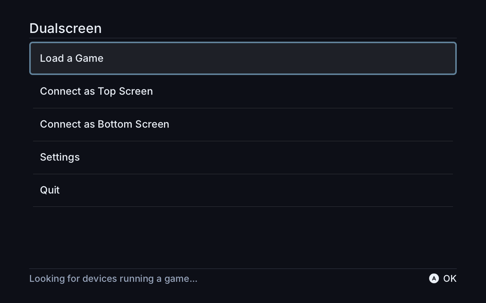
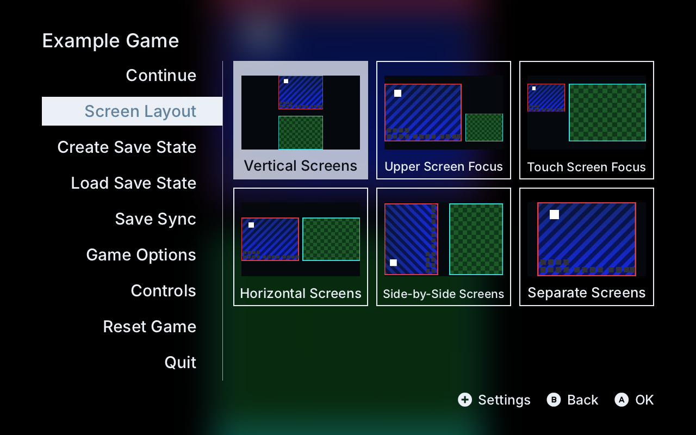
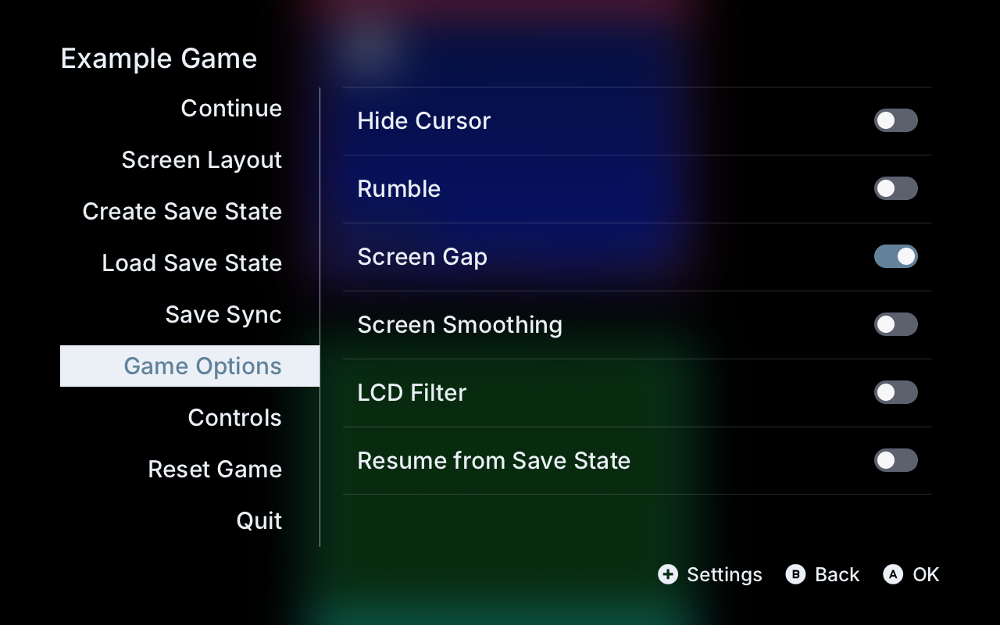
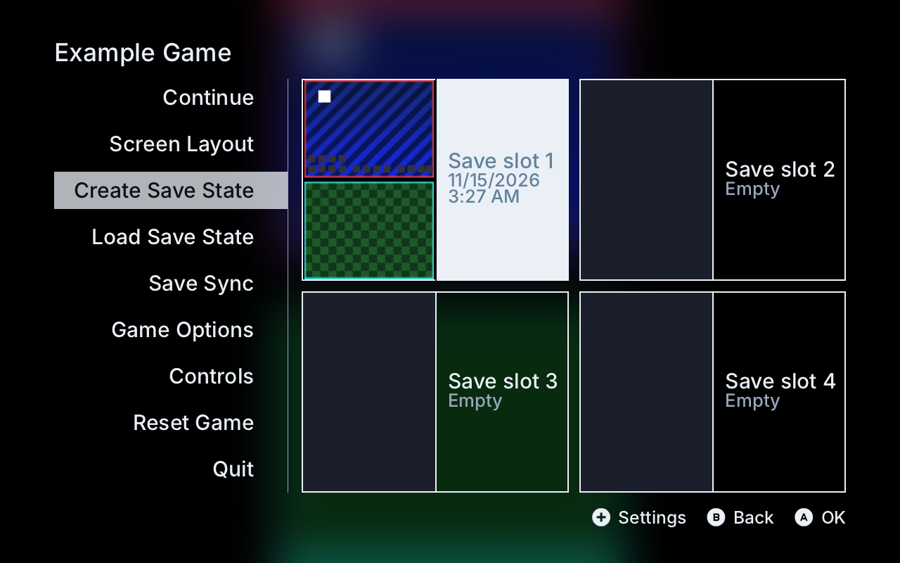
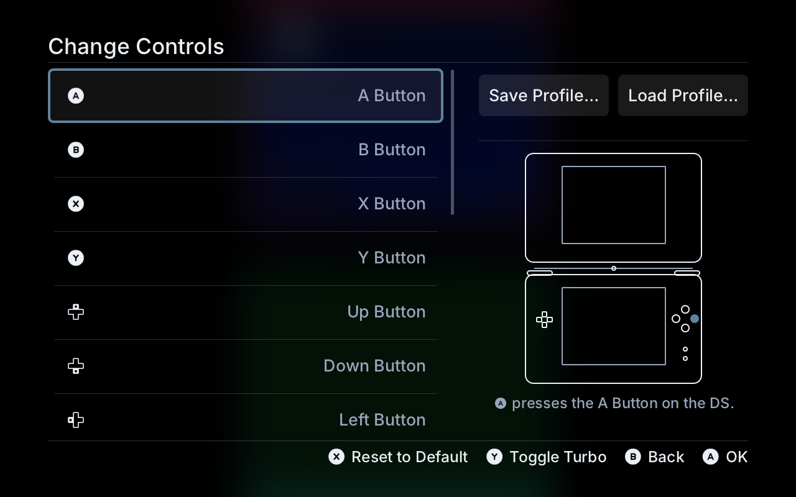
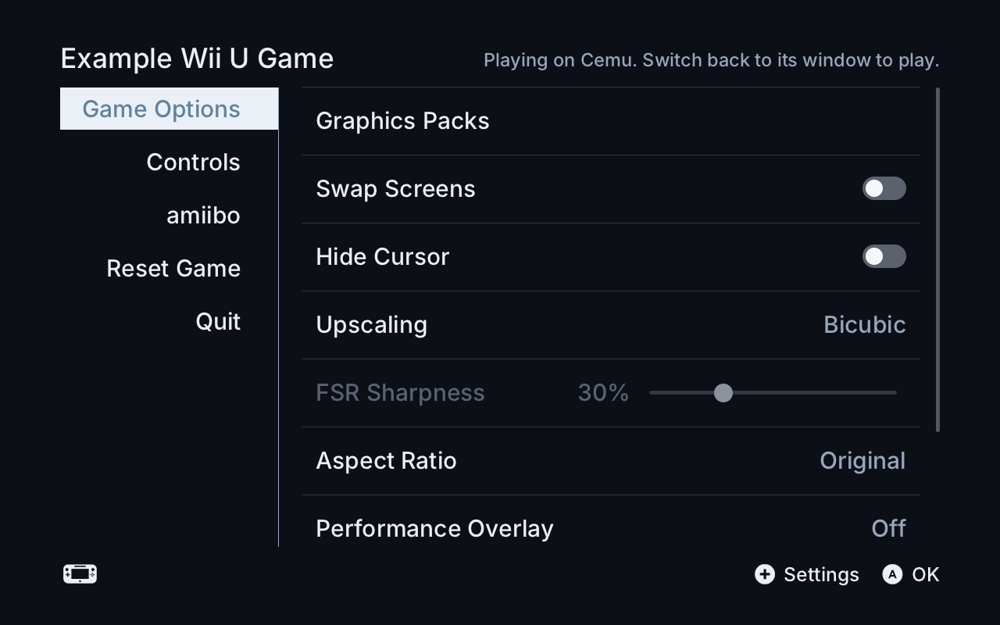
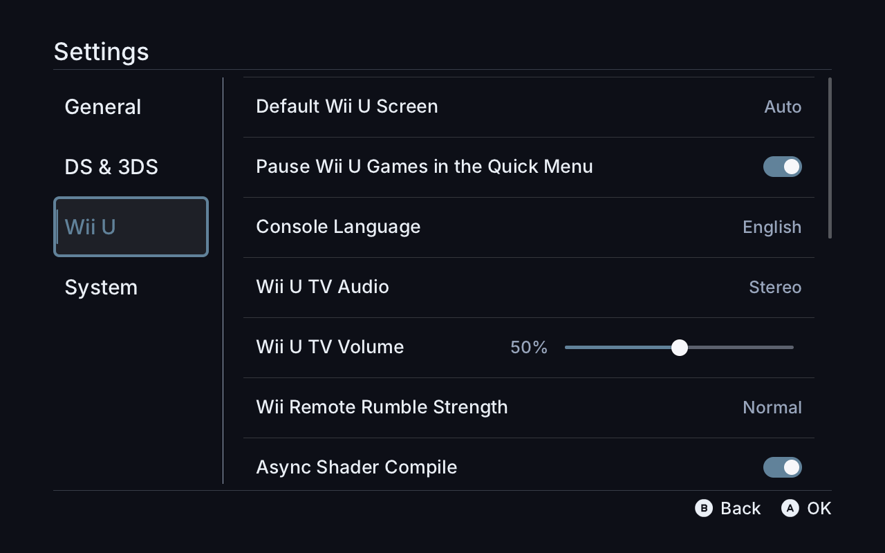

# Dualscreen

Dualscreen plays Nintendo DS, 3DS and Wii U games the way they were meant to
be played: on two screens. Put both screens on one display in the layout you
like, or spread them across two devices, so a Steam Deck in your hands is the
touch screen or GamePad while your TV shows the top screen.

It runs in Steam's Game Mode like any other game, is driven entirely with a
controller or touch, and looks and feels like a console's own menus.



## Features

- **DS, 3DS and Wii U games.** DS games run in melonDS DS and 3DS games in
  Azahar, inside Dualscreen itself. Wii U games run in this project's build
  of Cemu, which Dualscreen starts and talks to for you.
- **Pick your screen layout from a menu.** Vertical, Horizontal,
  Side-by-Side (for games held sideways), Upper Screen Focus, Touch Screen
  Focus, or Separate Screens, each previewed with your game in it. Each game
  remembers its own layout, with left- and right-handed versions.
- **Two devices, one game.** Run the game on a PC or a Steam Deck, and join
  it from a second device as the other screen. Both devices' controllers
  and touch screens work. A Nintendo Switch, an Android phone or handheld,
  an iPhone, an iPad, an Apple TV or a Mac can all be the second screen.
- **Start games from the other device.** With Remote Start on, a PC or a
  Steam Deck can be woken up and told to start a game from your handheld,
  with nobody sitting at it. Your recent games appear on the home screen.
- **A console-style quick menu**, laid out like Nintendo Switch Online's:
  change the layout, make and load save states, sync saves, change game
  options or controls, reset or quit.
- **Save states and Resume.** Four save state slots per DS game, and an
  optional resume point so a game picks up where you left it, even after a
  crash or a flat battery.
- **Save sync between devices.** Save Data Management moves DS, 3DS and Wii U
  saves between your devices over your home network, and keeps the last ten
  saves it replaced in case you want one back.
- **Controller remapping and profiles.** Remap any button, turn on turbo,
  and save mappings as profiles to load in any game.
- **Wii U extras.** Choose which controller is the GamePad and which are
  players, set each player as a Pro Controller, Wii Remote, Wii Remote +
  Nunchuk or Classic Controller, scan amiibo, and turn Cemu's graphics packs
  on and off, all from a controller.
- **Web Play.** Friends on your network, or on a VPN such as Tailscale, can
  watch and play your Wii U game in a web browser with their own controllers,
  with nothing to install. Whoever holds the GamePad sees its screen.
- **Touch Controls** on a phone or tablet with no controller: an on-screen
  pad below the game while you hold it upright.
- **Keeps itself up to date.** Dualscreen updates itself, and on a PC or a
  Steam Deck it downloads and updates the emulators it needs too.
- Plus: run-ahead to hide a game's own input lag, 3DS render scale up to 18x,
  rumble, gyro (Steam Deck, phones, Switch, controllers), 3DS custom texture
  packs, an LCD filter for DS games, screen smoothing, and Discord Rich
  Presence.

## What it looks like

| | |
| --- | --- |
|  |  |
| Choosing a screen layout, previewed with the game | Game Options for the game being played |
|  |  |
| Four save state slots per DS game | Remapping buttons, with profiles |
|  |  |
| A Wii U game's menu, beside Cemu | Settings |

The game in these pictures is a test pattern; your own game is shown there
instead.

## Which devices it runs on

| Device | Plays games itself | Second screen for another device | Download |
| --- | --- | --- | --- |
| Steam Deck and SteamOS | DS, 3DS, Wii U | yes | `dualscreen-steamos.tar.gz` |
| Windows PC | DS, 3DS, Wii U | yes | `dualscreen-windows.zip` |
| Other Linux PCs | DS, 3DS, Wii U | yes | build it (see below) |
| Nintendo Switch (homebrew) | DS | yes | `Dualscreen.nro` |
| Nintendo Switch 2 (homebrew) | not yet | yes | `Dualscreen-Switch2.nro` |
| Android | DS | yes | `dualscreen-android.apk` |
| iPhone and iPad | DS | yes | build it ([apple/README.md](apple/README.md)) |
| Apple TV | no | yes, as the top screen or TV | build it ([apple/README.md](apple/README.md)) |
| Mac | no | yes | build it ([apple/README.md](apple/README.md)) |

Wii U games need a PC or a Steam Deck, since that is where Cemu runs.

## Installing

Every build is published as the
[**nightly** release](https://github.com/joshbirnholz/dual-screen/releases/tag/nightly).
Once installed, Dualscreen tells you when there is a newer build and installs
it for you.

- **Steam Deck / SteamOS**: unpack `dualscreen-steamos.tar.gz` anywhere you
  can write to, and add `dualscreen` to Steam as a non-Steam game.
- **Windows**: unzip `dualscreen-windows.zip` anywhere, and run
  `dualscreen.exe` from its `Dualscreen` folder, or add it to Steam.
- **Switch**: copy `Dualscreen.nro` to `/switch/` on the SD card and start it
  from the homebrew menu. **Switch 2** (kaiHEN): the same with
  `Dualscreen-Switch2.nro`.
- **Android**: install `dualscreen-android.apk`.
- **iPhone, iPad, Apple TV and Mac**: build it with Xcode, as
  [apple/README.md](apple/README.md) explains.

### What you need to supply

- **Your games.** Dualscreen comes with no games and downloads none.
- **The emulators**, on a PC or a Steam Deck: the first time you start a
  game, Dualscreen offers to download the one it needs (melonDS DS, Azahar,
  or this project's Cemu). You can also download them from **Settings >
  System**. A Switch, an Android device and an iPhone or iPad have the DS
  emulator built in.
- **System files, if a game needs them.** DS games start without any, but
  for DSi games or a real DS boot, put your own BIOS and firmware dumps in
  the system folder. 3DS games may need the system files Azahar asks for, and
  Wii U games need whatever Cemu needs to run them. These have to come from your own consoles.

## Using Dualscreen

**Playing a game.** Choose **Load a Game** on the home screen and pick a ROM.
To go straight into one game from Steam, add Dualscreen as a non-Steam game
with `--game "/path/to/game.nds"` in its launch options, one shortcut per
game.

**The quick menu.** Open it with **L3 + R3** (both sticks pressed), **F1**,
a two-finger tap on a touch screen, or any button you map to **Open Menu**.
On a phone or tablet, a controller's Home button opens it too. Choose **Screen Layout** to
pick a layout, then **Continue** or **B** to go back to the game.

**Playing on two devices.** Start the game on the device that will run it.
On the other device, open Dualscreen and choose **Connect as Top Screen** or
**Connect as Bottom Screen**. It finds the game on your network and joins.
The bottom screen's device is the one whose touch screen works, and the
controllers on both devices play. Choose **Separate Screens** in the quick
menu to put one screen on each device. Either device can open the quick
menu, and **Disconnect** ends the session.

**Starting a game from your handheld.** On the PC or Steam Deck, turn on
**Settings > System > Enable Remote Start**. After you join a game there once,
your handheld's home screen shows the games you last played on it. Choose one,
and the PC is woken up (if Wake-on-LAN is set up), the game starts, and your
handheld joins it.

**Wii U games.** Pick a Wii U game the same way. Dualscreen starts Cemu,
which shows the game, while Dualscreen's own window shows the quick menu.
The device in your hands can be the GamePad and your TV the television, or
the other way round. See the [guide](docs/guide.md#wii-u-games) for setting
up controllers and players.

**Playing Wii U games in a browser.** Turn on **Settings > Wii U > Web Play**
and open the address it shows on another device. See
[Web Play](docs/web-play.md).

**Syncing saves.** Open **Settings > System > Save Data Management**, or
**Save Sync** in a game's quick menu, to move a save between devices on your
network. Nothing moves unless you choose it.

**Steam Input.** On a Steam Deck, or anywhere you play through Steam, the
buttons are whatever Steam Input says they are. If a button does the wrong
thing, change it in Steam's controller settings for the shortcut.

The [guide](docs/guide.md) covers all of this in detail, along with every
setting and option.

## Building it yourself

Every platform builds from this repository. On Linux or a Steam Deck:

```sh
git clone https://github.com/joshbirnholz/dual-screen
cd dual-screen
./tools/build-steamos.sh          # a Steam Deck, or any Linux PC
```

| Platform | Command |
| --- | --- |
| Steam Deck / SteamOS | `./tools/build-steamos.sh` |
| Linux | `cmake -S . -B build && cmake --build build -j` |
| Windows (cross-compiled from Linux) | `./tools/build-windows.sh --package` |
| Nintendo Switch / Switch 2 | `cd switch && make` (`make SWITCH2=1` for a Switch 2) |
| Android | `cd android && ./gradlew assembleDebug` |
| iPhone, iPad, Apple TV, Mac | `apple/build-all.sh` |

[docs/building.md](docs/building.md) lists what each one needs, and how to
build the Cemu fork for Wii U games.

## Technical documentation

- [docs/guide.md](docs/guide.md): everything Dualscreen does, in detail.
- [docs/technical.md](docs/technical.md): how it works: streaming between
  devices, latency, where files are kept, `settings.json`, the command line
  and the tests.
- [docs/building.md](docs/building.md): building for every platform, and how
  updates are published.
- [docs/web-play.md](docs/web-play.md): Web Play, certificates and playing
  over the internet.
- [docs/cemu-integration.md](docs/cemu-integration.md): how Wii U games are
  played through Cemu.
- [switch/README.md](switch/README.md), [android/README.md](android/README.md)
  and [apple/README.md](apple/README.md): the Switch, Android and Apple
  builds.
- [THIRD_PARTY.md](THIRD_PARTY.md): the third-party code and art used here.
