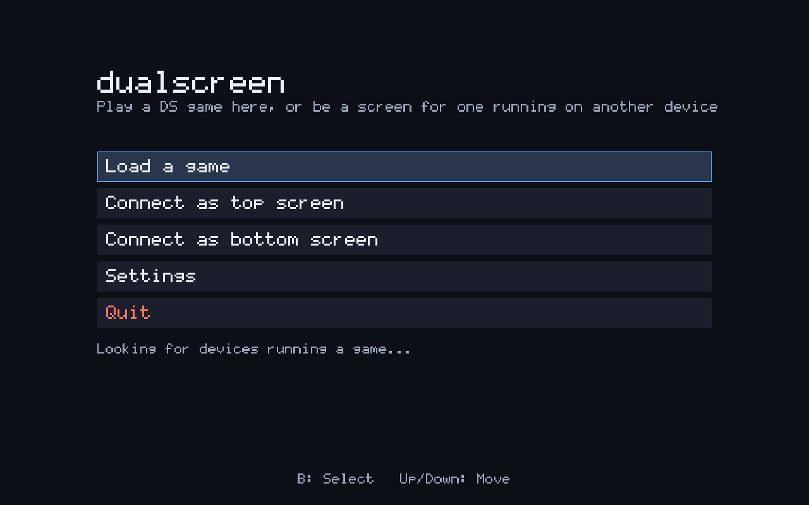
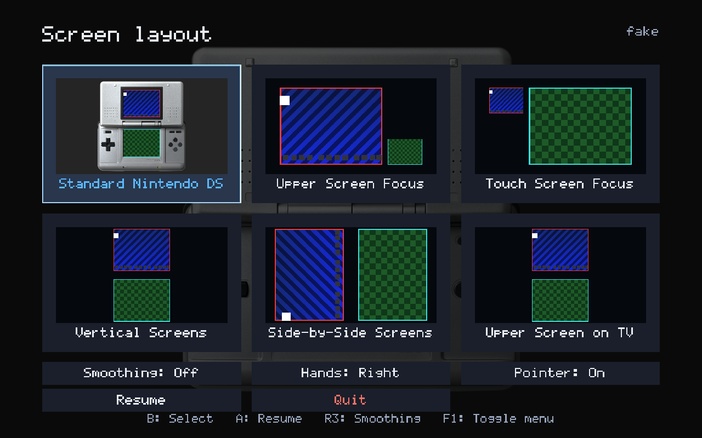
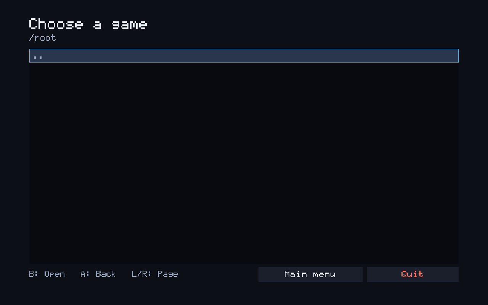

# Dualscreen

A shell for playing dual-screen games on Linux/SteamOS that treats each screen
as its own addressable source, so you pick a screen layout from a visual menu
instead of cycling a button — and the choice is remembered per game.

Two devices can share one game: whichever device runs it serves a screen over
the network to the other, which sends its input back. Either device can be the
one running the game.







## What it does today

- Plays **Nintendo DS** and **Nintendo 3DS** games, picking the console from
  the ROM's extension and loading that console's core — including cores that
  render on the GPU, which is the only way Citra runs at all.
- Embeds the libretro core directly — **melonDS DS** for DS games, **Citra**
  (or a fork) for 3DS ones — `dlopen`'d as a library, with the libretro
  frontend implemented here. RetroArch is not involved and does not need to be
  installed.
- Pins the core to a single known internal layout and splits its framebuffer
  into two textures — top screen and bottom screen — every frame.
- Composites those two textures into **your chosen layout**, which is entirely
  independent of whatever the core is doing internally.
- Runs as one fullscreen window, so it behaves like any other non-Steam
  shortcut under gamescope / Game Mode.
- Controller input via SDL2's GameController API; touch input on whichever
  screen is currently showing the bottom screen, mapped back into the
  console's own touchscreen coordinates.
- Remembers the chosen layout per game, keyed by the ROM's SHA-1 rather than
  its path, so moving your ROMs around loses nothing.
- Writes cartridge saves as `.srm` files, interchangeable with RetroArch's.
- **Save states** for DS games, four per game, from the quick menu —
  laid out like Nintendo Switch Online's suspend points.
- **Two-device play**: one device runs the game and shows a screen; the other
  finds it on the network, shows the other screen, and sends its touches and
  buttons back.
- Launched with no ROM, it opens a file browser so you can pick one, and starts
  in whichever folder you were last in.
- Takes a **Wii U**'s two screens from an emulator running beside it rather than
  from a core inside it, and treats them like any other console's from there.
  Finished and tested on this side; no emulator speaks it yet.

## The quick menu

On a DS or 3DS game the quick menu is laid out like Nintendo Switch Online's:
a list down the left, and whatever the highlighted entry holds on the right.

It comes up from the game the way a console's does: the blurred game behind
it fades in quickly, then the menu fades in and grows the last little way
into place, just after -- all in under a quarter of a second, on both
devices. Closed back to the game, it goes the other way: the menu fades and
shrinks first, then the backdrop, the game already going underneath. Going
into one of its pages, or back to it from one, has no animation.

Every list in the app — the main menu, Settings, the file picker, Data
Management, this menu's options — stops at its first and last entries rather
than going round. The one exception is this menu's list down the left: a
press past its bottom goes to its top and back, though holding a direction
still stops at the end. Holding a direction anywhere keeps moving, about 13
steps a second after the first.
With a finger, a first tap highlights an entry and a second tap on it chooses
it, so a touch that lands on the wrong thing only moves the highlight. A list
longer than the screen follows the finger smoothly when dragged, keeps gliding
after a flick and slows to a stop; a touch on a gliding list stops it there
without choosing anything.

| entry | what it shows or does |
| --- | --- |
| **Continue** | back to the game, the same as B |
| **Screen Layout** | the layouts below, each drawn as a picture of the paused game in it, and under them a square button with the Wii U's own stylus-hand symbol: press it to flip the layout in use for the other hand, and the symbol flips to show which. Each layout remembers its own hand. The button is hidden for layouts that are the same either way round, like Vertical Screens. Under Separate Screens the same place has an ↑↓ button instead, which swaps the screens |
| **Create Save State** | the four save state slots (DS only); see [Save states](#save-states) |
| **Load Save State** | the same slots, to go back to one |
| **Save Sync** | this game's page in [Data Management](#data-management), to sync its save with another device or go back to an earlier one (DS and 3DS). Leaving the page comes back to this menu |
| **Game Options** | the settings you might change mid-game, kept for each game, as a list: render scale (3DS), sound (with two devices), pointer, right stick (see [The right stick](#the-right-stick)), left stick click (DS: the microphone, or swapping the focus layouts), rumble (DS; see [Rumble](#rumble)), screen gap (one choice for every layout that has a gap: Vertical Screens and the two focus layouts), screen smoothing, LCD filter (DS: the screens drawn with a handheld LCD's pixel grid over them, as Nintendo's own classics apps offer, kept for each game and shown on both devices), and resume from save state (DS; see [Resume from save state](#resume-from-save-state)) |
| **Disconnect** | ends a two-device session; only there while one is running |
| **Reset Game** | restarts the game, after asking |
| **Quit** | closes the game, after asking. Chosen on the companion, it closes the app there too rather than going back to its main menu (except on an iPhone, iPad or Apple TV, where apps do not close themselves) |

The menu opens on Continue the first time, and after that on whichever entry
it was last closed on. Up and down move through the list, and the right-hand
side follows. Right or A goes across onto it, always onto its first thing, top
left; left from its edge comes back. B resumes the game from anywhere in the
menu, the list or the right-hand side. **+** opens Settings, and the old face-button
shortcuts (X quit, Y reset, R3 smoothing) still work, though the
guide no longer shows them. A Wii U game's menu stays a plain list.

### Your DS's name, favorite color and birthday

**Nickname**, **Favorite Color**, **Birth Month** and **Birth Day**, in
Settings, are what a DS's own settings keep about its owner: a DS game that greets you by name
uses the nickname, one that themes itself uses the color, and one that marks
your birthday uses that. melonDS DS is told all three as a DS game starts.
The name is typed into a field -- on a Steam Deck, Steam's on-screen keyboard
comes up for it; on a Switch, the system keyboard -- and is ten characters at
most, as on a DS. The color is picked from a grid of the DS's sixteen, in the
DS's own order, and is Gray until another is chosen; it is the menus' accent
too, exactly as the DS shows it -- the cursor's ring is drawn in it. The birthday is its month and its day, each chosen on
its own; until one is chosen melonDS DS keeps its own. A 3DS has none of these to set:
Azahar's libretro core takes no name, color or birthday.

### Dropdowns

A setting with several values opens them in a small box beside its row, the
value in effect filled in. The box stays where it opened; a list longer than
it shows scrolls inside it -- with the cursor, a finger dragged up or down, or
the mouse wheel. Every list in the app scrolls with the mouse wheel.

### Touch, mouse and wheel

Every menu works the same under a finger, the mouse and the mouse wheel, on
whichever device it is drawn: a list is dragged, flicked or turned with the
wheel; a first tap on a row highlights it and a second chooses it; a tap off
an open popup puts it away. A page of the host's drawn on the connected
device -- the quick menu, Graphics Packs, Controller Order, the amiibo
browser -- is one page on both: where it is scrolled, the cursor and any
popup are the same on both screens, whichever is scrolled or tapped, and a
tap there is sent over as the thing it landed on, so the host answers it
exactly as it would its own. (Settings and its pages are each device's own.) Over a Wii U game, the quick menu is
drawn inside Cemu's window, and this project's Cemu build passes the mouse
through to it, wheel and dragging included.

Each page is a `MenuPage` (`src/ui/menu_page.hpp`), which hears every tap in
one place and says where it is scrolled in a measure that is the same at any
screen size; the `lint_menu_pages` test fails for a page that reads its own
pointers instead, and every screen of the app has to say whether the other
device shows it, so a menu added later cannot leave any of this out.

### Sound Effects

Every menu in the app makes a sound when a press does something: the cursor
moving, something chosen, backing out, an error appearing, and the quick menu
opening over a game, whichever device opened it. Closing it is backing out,
and sounds like it, however it was closed. A switch -- an On/Off setting --
has a sound of its own for each way it is flipped, on and off. A press that
changes nothing -- the cursor already at the end of a list -- makes none, and
nor do a game's own buttons while it is playing. A popup's Cancel sounds the
same whether it is chosen with A or backed out of with B, and a press that
closes the app -- Quit, or anything that leaves to start it again -- is
silent rather than cut off part way through. With two devices, the quick menu
is heard on both, as it is seen on both, whichever pad is working it: the
device running the game decides each sound, the same way for a press from
either pad, and sends it to the other to play as well -- and so do its
Settings pages opened from the menu, which the other device's buttons work
too.

They are dry plastic ticks and pops, the closest to a modern console's menus,
and this project's own: synthesised from sine waves and noise by
`python3 assets/synth_ui_sounds.py` into `assets/ui_sounds/click/`, so they
carry nobody else's licence. `python3 assets/make_ui_sounds.py` trims them to
the sound, converts them to 48 kHz stereo and packs them into
`assets/ui_sounds.bin`, which is built into the app.

They play on an audio device of their own, opened at start-up, not with the
game's sound, which is queued a tenth of a second deep and paused while a menu
is up. On a Switch that is the console's plain audio output, beside the audio
renderer SDL plays the game through, fed by a thread that runs just above
the app's own so a busy frame cannot leave it with nothing to play; voices that
overlap are summed and then eased under full scale rather than clipped. Where SDL can open only one device at a
time -- Android, and a run with `SDL_AUDIODRIVER=dummy` -- there are no menu
sounds, since the game's sound needs that device; the log says which at
start-up (`menu sounds ready`, or `no menu sounds:` and why). **Sound Effects**
in Settings turns them on and off (`ui_sounds` in `settings.json`). A companion with
no Settings of its own -- on a desktop, an iPhone, an iPad or an Apple TV --
always plays them.

## Layouts

These are the Wii U Virtual Console's own Screen Settings, in its order and
under its names — that list is what this app is trying to be.

A game starts in **Vertical Screens** the first time it is played, and after
that in whatever it was last played in.

In the menu's order:

| id | name | what it shows |
| --- | --- | --- |
| `vertical` | Vertical Screens | the DS's arrangement without the console around it |
| `upper_focus` | Upper Screen Focus | the upper screen large, the touch screen small in the corner |
| `touch_focus` | Touch Screen Focus | the touch screen large, the upper screen small in the corner |
| `horizontal` | Horizontal Screens | both screens upright at the same size, next to each other |
| `side_by_side` | Side-by-Side Screens | held sideways: both screens turned a quarter turn |
| `upper_on_tv` | Separate Screens | one screen per device, each filling its own display — and alone, one screen and nothing else |

`standard` — both screens inside a drawing of the console itself — is still
there, and `--layout standard` still shows it, but it is hidden from the menu
for now, and a game that remembered it starts on Vertical Screens instead.

**Separate Screens** with nobody else connected shows just one screen, filling
the display: the one to watch in a game where only one of the two matters. The
↑↓ button beside the layouts swaps which, and so does **L3** while playing
(with Left Stick Click set to swap, or **F3** on a keyboard); each game
remembers which screen it was last shown on. With a second device connected
it is one screen on each, and the same swap trades them between the two —
from either device.

The arrangements are measured off the Wii U's own output rather than eyeballed:
the sizes, the gaps and the alignments all come from its Screen Settings shots.
In the two focus layouts the small screen sits where that screen sits on a real
DS — the touch screen low, the upper screen high — so one pair is bottom-aligned
and the other top-aligned.

The two focus layouts are the same pair of screens with the emphasis reversed,
and which one you want changes with what the game is doing, so **L3** swaps
between them while playing (under Separate Screens it swaps the screens instead) — no menu, no pause — keeping whichever hand the
stylus is set for: a left-handed focus layout swaps to the other one
left-handed too. On a DS that is one of two
things L3 can be: **Left Stick Click** under Options in the quick menu chooses
between that and holding the DS's microphone, for games that ask to be blown
into. Held, it reaches melonDS DS as whichever button the core itself calls
its microphone: L3 from version 1.3, and L2 before that, when L3 closed the
DS's lid -- which, pressed by mistake, blanks both screens and pauses the game
until it is pressed again. Like everything else on that menu it is the host's, and both devices'
L3 follow it while they are connected. L3 does nothing under any other
layout but Separate Screens, and like everything else on that menu it is one choice for both devices:
pressing it on the companion asks the host, the same as picking the layout from
the menu would. **F3** does the same from a keyboard.

**Hands** in the menu mirrors the layouts that put one screen beside another, so
the touch screen is under whichever hand holds the stylus. It is one toggle
rather than a left-handed twin of every layout, and it turns the sideways
screens the other way too.

`vertical`, `horizontal` and the two focus layouts have a **Gap** toggle in
the menu, on by default, for the space between their screens. Side-by-Side is the one
exception — its gap stands in for the DS's own hinge, so it stays fixed —
but everywhere else, screens flush against each other are a real option, not
a broken one, so the gap is left up to the player. The layout previews update
live as the toggle changes, the same as picking a different layout does.

On a display no bigger than a Deck's — a Switch's 1280x720 included — `standard`
fills it with the **screens** rather than with the picture around them. Fitting
the whole console in leaves the screens at a fraction of the display with the
rest given over to plastic and grey: measured on a 1280x720 panel, a 3DS's two
screens came to 89% of the height of a picture only 694 pixels wide. The console
is scaled up until the screens span the display and the artwork simply runs off
the top and bottom, which is what a handheld held in two hands should look like.
A display with room to spare still gets the whole console, uncropped.

`standard` draws an illustration of the console itself and puts the two screens
exactly where its own are, on a #252525 surround rather than black — that is the
artwork's own background colour, so the picture has no visible edge. There is one
picture per console, a DS and a 3DS, and the game being played decides which is
drawn. See [THIRD_PARTY.md](THIRD_PARTY.md) for a note about where those images
came from.

Both are scaled to fit whatever display they are drawn on, the same picture
the Wii U Virtual Console's own Screen Settings shows at any size — filling
the screen rather than sitting pinned to the artwork's own pixel size on a
small display.

Every layout works on both consoles. A 3DS's two screens are different shapes —
400x240 above, 320x240 below — and each layout measures each screen against its
own size rather than assuming they match, so the wider upper screen stays wider
and the narrower touch screen stays centred beneath it — `standard` included,
which has its own 3DS to draw them into.

`upper_on_tv` is the two-device layout: each device fills itself with the screen
it owns. Pick any other and both devices show the whole thing, which is what you
want when someone is watching over your shoulder. With no second device
connected it falls back to showing both screens, since half a game is not
useful.

## Wii U games

A Wii U is not played the way a DS or a 3DS is. Those load a libretro core into
this app; there is no usable Wii U core to load, so a Wii U is played by **Cemu,
running beside this app**, handing its two pictures over.

Everything on this side of that handover is finished: the shell opens a socket,
takes a television screen and a GamePad screen from whatever connects, arranges
them under the same layouts as any other console, and can send one of them on to
a second device.

The Cemu that speaks it is a fork — `joshbirnholz/cemu-dualscreen`, branch
`claude/dualscreen-frame-link`. It taps the frames where Cemu's own screenshot
path is tapped, reads them back without ever waiting for the GPU, and takes the
whole GamePad from the link while the shell is connected. Vulkan only.
Confirmed against a real session on a Steam Deck: video, pad, touch and both
TV and GamePad audio all working. `docs/cemu-integration.md` is the full
account, including the one remaining gap — Reset — and why it is where it is.

`tools/fake_wii_u` stands in for it in the tests, which is what
`tests/run_wii_u_test.sh` and `tests/run_wii_u_companion_test.sh` drive.

The shell starts the emulator itself, from a command you configure. That is not
a convenience: in Game Mode there is no desktop to start one from, which is the
whole reason this app exists. In `settings.json`:

```json
{
  "wii_u_program": "/path/to/cemu",
  "wii_u_arguments": ["--dualscreen-socket", "{socket}", "--game", "{game}"]
}
```

Those arguments are the default, because they are the fork's; only the program
has to be set. They are written out in full because nothing here knows what a
different fork would call its own flags. `{socket}` becomes the path it should
hand its screens over on and `{game}` the file you picked; everything else is passed through
untouched, with no shell in between. Quitting the shell stops it again.

The Settings screen lists it beside the DS and 3DS cores, so a machine that is
not set up for a console says so before you pick a game rather than after.

Leave `wii_u_program` empty to start it yourself — which works on a desktop, and
does not work from a Steam shortcut. Either way, a device sitting there before
the emulator exists says so rather than showing a blank window: the host names
the socket to point at, and the second device says which machine it is waiting
on.

Three things are different about a Wii U session:

- **One device shows one screen.** The television is the game and the GamePad is
  a second view of it, so squeezing both into one window is not the arrangement
  the console has. With a second device connected, each holds one. Alone, the
  device is whichever screen **Default Wii U Screen** on the Settings
  screen says — and Cemu is told, so its own window shows that screen rather
  than whatever it was last left on. **F3** swaps it for the rest of a session
  without writing anything down.

  That setting is **Auto** by default. On a Steam Deck's own 1280x800 panel
  the device is the GamePad; on any other display it is the television. So a
  Deck in the hand is the GamePad and the same Deck on a dock is the
  television. It is decided when the game starts. A Deck's display does not
  change size under a running app, so docking takes effect the next time
  Dualscreen is started. **TV** and **GamePad** pin
  it to one. The log says which it picked and why:

  ```
  alone, this device is a Wii U's television (Auto, on a 1920x1080 display, which is not a Steam Deck's own panel)
  ```

  Motion in the GamePad role comes from whatever this device reads its own
  sensors through, which on a Steam Deck in Game Mode means
  [SteamDeckGyroDSU](https://github.com/kmicki/SteamDeckGyroDSU) — Steam Input
  hands SDL a pad with no sensors on it, so there is nothing else to read. See
  **Motion** below. If nothing answers, the log says so:
  `motion: nothing has answered at 127.0.0.1:26760 …`.

  On a desktop, Auto means the television, and the GamePad is then whatever
  you have set up in Cemu. That is how to play the many games that never ask
  for the pad, with a controller already configured for them.

- **The GamePad belongs to one controller, and every other controller is a
  player.** By default the device showing the GamePad screen gives the GamePad
  its first controller. Every other controller on either device is Player 1,
  Player 2 and so on, in order. See **Players** below. A DS or a 3DS is
  different: two people share one console there, so both devices' controls are
  merged.

- **The quick menu is on screen the whole time.** While Cemu's window plays
  the game, this app's own window shows the Wii U menu in place of a
  "Playing on Cemu" notice, laid out as a DS or 3DS game's is -- sections
  down the left, and the highlighted one's things on the right: **Game Options**,
  **Controls**, **amiibo**,
  **Disconnect**, **Reset Game** and **Quit**, with **Settings** on plus as
  on every console's menu. Cemu cannot restart a game itself, so **Reset Game** closes the
  Cemu this app started and starts it again on the same game. It
  answers only while its window has the focus, so a press meant for the game
  never picks Quit. Opened over the game, the menu also starts with
  **Continue**, which goes back to it.

- **The quick menu also opens over the game, in Cemu's window.** With this
  project's Cemu build, **F1** or **Escape** in Cemu's window, or the menu
  button on a pad, puts the quick menu up over the game without switching windows. The game is
  darkened behind it but keeps running, and pads work the menu while it is up.
  It is the same menu on both devices: opened from a companion, it shows in
  Cemu's window too. **F1**, or **B** or **Escape** on the list, puts it
  away. Escape no longer leaves Cemu's fullscreen while this app is attached;
  **F11** or **Alt+Enter** still does. Not **Tab**,
  which Cemu keeps for itself: held, it shows the GamePad's screen.

- **Graphics Packs**, the last of a Wii U game's **Game Options** in the quick
  menu, is Cemu's own Graphic Packs window
  laid out as the quick menu is, so the packs can be changed with a controller
  in Game Mode, where that window is out of reach: the game's packs down the
  left, grouped as Mods, Enhancements and so on, and on the right the one
  highlighted -- on or off, each of its presets, and what it says about
  itself. **Right** or **A** goes into a pack, **Left** or **B** back to the
  list; inside it, **A** turns it on or off, or opens a preset's choices beside it.
  Cemu makes each change as it is chosen and keeps it, exactly as its own
  window would. A pack that replaces textures (most resolution
  packs) is only read as the game starts, and the page then says its change
  will take effect once the game is restarted -- which **Reset**, a step back,
  does. It needs this project's Cemu build. A second device shows the same
  page, the cursor where it is, and works it with its own pad.

- **Game Options**, in the quick menu, are this game's, as a DS or 3DS game's
  are, each stepped on with **A**: first **Graphics Packs**, which opens the
  page above, then **Swap Screens** (played alone: the other
  screen from **Default Wii U Screen** -- **F3** does the same; with a second
  device connected, the two trade screens), **Hide Cursor** (this device's own,
  as on every console's menu; placing a Touch Point always shows it), then Cemu's: **Upscaling** (how Cemu enlarges
  a picture smaller than its window: bilinear, bicubic, Hermite or nearest
  neighbor), **Aspect Ratio** (the game's own, or stretched to the screen),
  **Performance Overlay** (off, frame rate, frame rate and CPU, or
  everything Cemu can show) and **CPU Mode** (auto, multi-core or
  single-core, for a game that misbehaves). Cemu keeps the first three for
  every game alike, so Dualscreen keeps each game's choice and sets it as the
  game starts, Cemu's default where the game has none; they change at once.
  CPU mode is kept in Cemu's own profile for the game, and changes when the
  game is reset.

- **Player 1 Controller** to **Player 4 Controller**, in Controls, are
  what each player's controller is to the game -- **Pro Controller**,
  **Classic Controller**, **Wii Remote**, **Wii Remote + Nunchuk**, **Wii
  Remote + Classic Controller** or **None** -- kept for each game and set as
  it starts, so a game that wants Wii Remotes and one that wants Pro
  Controllers each get theirs without a trip to Cemu's input settings. A
  change happens at once, as if the controller had been swapped. Cemu's own
  saved controller profiles are left as they were: a game with nothing chosen
  gets what Cemu started with.

  A player's controller is only plugged in while a pad is feeding it: unplug
  the pad, or move it off the player in Controller Order, and the game sees
  that controller disconnect, as a real one's would; it comes back, as the
  type this game wants, when a pad does. So a game never counts controllers
  nobody is holding.

- **A game's own dialogs** -- its keyboard, when it asks for a name (a horse's
  in Breath of the Wild), and its error messages -- are this app's popups
  rather than Cemu's small windows. The keyboard is the popup a DS nickname is
  typed in, with Steam's on-screen keyboard on a Steam Deck -- both sit in the
  top of the screen, clear of an on-screen keyboard: what is typed in
  Cemu's window shows in it as it is typed, OK hands it to the game, and
  Cancel leaves the game what it started with. A message has the game's own
  buttons, or OK; with only one, B presses it. The game goes on underneath,
  and one put up while the quick menu is open waits until it closes. A
  connected device shows the same popup and can answer it; when it is the
  GamePad -- the device in your hands -- the keyboard comes up there instead
  (a Switch's own keyboard on a Switch), and what is typed shows on both.

- **Wii U TV Audio**, in Settings, is Cemu's TV channels -- **Mono**,
  **Stereo** (Cemu's default) or **Surround** -- the same for every game.
  Dualscreen tells Cemu as it connects, and again when it is changed; Cemu
  opens the TV's sound as a game starts, so a game already running hears the
  change once it is reset. It needs this project's Cemu build.

- **amiibo**, in the quick menu, lists the amiibo dumps (`.bin`, `.nfc`
  or `.dat`) in the amiibo folder, and a level or two of folders inside it,
  by name on the right. The folder is `~/amiibo` (or `~/Documents/amiibo`)
  until another is chosen with **Choose a Folder...** at the end of the list,
  which browses to one and scans the amiibo picked there. Choosing one
  closes the menu, and four seconds after the game is going again it is
  held to the GamePad, as Cemu's own "Scan NFC tag/amiibo from file" does --
  a game only sees a figure for the couple of seconds it is there, which a
  paused one would miss, and one coming back from its HOME Menu (Breath of
  the Wild) shows a loading icon of its own for a moment first. Until Cemu
  says it has been read, the top right corner says **Scanning…** -- on the
  connected device too, as every corner alert is; the game says the rest. A file that is not an amiibo dump is said to be so
  in a popup, and the menu stays up.

- **Hide Cursor** hides or shows the mouse pointer over Cemu's window, as it does
  over a DS game. Shown, it appears when a mouse or trackpad moves it -- even
  with Cemu filling the screen, as in Game Mode -- and hides again when it is
  still, and a click with it on the GamePad's screen is a touch there. Hidden,
  it never shows. Touches on the screen itself work either way.

- **None of the controller shortcuts exist.** A Wii U game reads every control
  the console has, including both stick presses, so nothing is taken from the
  pad — no L3, no R3, no chord, no two-finger tap. The menu is always on
  screen on the device running the game (see above), and **F1**, **Tab** or
  **Escape** on a companion; smoothing is **F2**, and Steam Input can be pointed at any of them. Which is
  also why every button on the pad, and both triggers as ZL and ZR, go straight
  through to the game — including from the second device, whose touches arrive
  as touches on the GamePad's own screen.
- **Screens go out as H.264, rather than as changed tiles.** A GamePad screen
  in motion measures at 42.8 Mbit/s as tiles and 2.45 as video — see **What
  streaming a screen costs** below. The host picks that by itself; if the other
  device cannot decode video, it sends tiles instead.

Cemu owns everything about the emulation: the resolution it renders at, its own
controller bindings, its own saves. The shell offers no render scale for a Wii U
because that setting is not its to offer.

### Controls, and where they are configured

Whatever is holding the GamePad screen appears in Cemu's own **Input Settings**
as a controller called **DualScreen GamePad**, under an API called
**DualScreen**. Add it to Player 1's Wii U GamePad the way you would any other
pad. It is listed whether or not a session is running, so a game's controls can
be set up in advance.

One controller, whichever way you are playing: on two devices it carries
whatever the device showing the GamePad screen is holding, and on one it
carries this device's first controller. Set it up once and both work.

That makes it an ordinary Cemu controller in every way that matters. Wii U games
want wildly different control schemes, and this is where they get them: buttons,
both sticks, stick deadzones and motion all go through Cemu's normal mapping and
its per-game profiles.

Rumble goes to whichever controllers are the GamePad, on either device.

Adding it applies a default mapping straight through — A to A, and so on — and
switches its motion and rumble on, so a fresh setup plays correctly with nothing
further configured. Every part of that is yours to change afterwards.

Touch is the exception, and is not in the mapping: the companion's touchscreen
drives the GamePad's directly, because a point on a screen is not a control a
button mapping can name.

### Players

Every other controller reaches Cemu the same way, as **DualScreen Player 1** to
**DualScreen Player 8** under the same **DualScreen** API. Map them in Cemu
once, as Pro Controllers, Classic Controllers or Wii Remotes, and a default
mapping is applied. Which physical controller sits behind each player is
decided here, not in Cemu, so the mapping stays put while the controllers
change.

Controllers on both devices count, and they stand in one line: the first is
the GamePad, the next eight are Player 1 to Player 8, and anything after that
is not used. One controller to each: no two controllers are ever the same
player, and none share the GamePad. By default:

- The device showing the GamePad screen gives the GamePad its first
  controller. A companion with no controller of its own, such as a phone,
  leaves the GamePad to its touch screen and motion.
- Every other controller is the next player: this device's first, in order,
  then the companion's.

Steam keeps spare virtual controllers, and one stays behind after its
controller disconnects. SDL lists those as plain "Steam Virtual Gamepad" with
nothing behind them. They are left out, and a slot reappears as soon as a
controller is behind it again.

Keyboards are not in the line at all. Map a keyboard in Cemu directly, with
Cemu's own **Keyboard** API, if a game wants one.

Controllers start out in each device's own order, which under Steam Input is
Steam's. Each is shown with the name Steam gives it, where there is one, and
which device it is on and which player slot that device has it in, such as
"steamdeck P2" or "Switch Lite P1". Set `device_name` in settings.json to
change what this device is called there. The name is only shown: a virtual pad's name is fixed
when it appears, and after controllers come, go and are reordered it can
describe a different controller from the one behind it.

**Controller Order**, at the top of the quick menu's Controls, rearranges the line the way SteamOS's own
Controller Order screen does. Each row starts with what that controller is:
the GamePad, drawn as one, or a player, drawn as four small squares the way a
Wii Remote's lights show it -- the second square alone filled for Player 2,
as a Wii U lights them, rather than the first two a Switch would. A Wii U
stops at four; Players 5 to 8 take a Switch's patterns. A controller in
neither has nothing there. Press confirm to pick a controller up, move it
up or down, and press confirm again to put it down. Moving one up from Player 1
makes it the GamePad; moving one down past the last player puts it in **Not
used**. Press **X** or **Y** (Identify) to give the highlighted controller
one short buzz, which is how to tell them apart. Either works, because which of
them a pad calls X depends on the pad. A Switch Lite has no rumble motor, so
its own controls cannot buzz. It works mid-game and from either device's
buttons, and lasts until the app closes: a controller is recognised for as long
as it stays connected, so one that is unplugged and plugged back in joins the
end of the line.

A player's rumble goes to its controller, on whichever device it is on. A
companion older than this needs updating to have its controllers counted one
by one. Until then it counts as one controller.

Each DualScreen controller's **Settings** button in Cemu offers motion, rumble
on or off, and a deadzone and range for each stick. On a Wii Remote, the
default mapping puts 1 on the north face button and 2 on the west one.

### Motion

A GamePad has a gyroscope and an accelerometer, and plenty of Wii U games steer,
aim or look around with them. Whichever device is holding the GamePad screen is
the thing being tilted, so that device's own sensors are what the game reads --
a Steam Deck's, a phone's, a Switch's, or the ones in a pad plugged into the
machine running Cemu.

What crosses the link is raw: rotation in radians per second and acceleration in
metres per second squared, exactly as the sensors report them, with the moment
each was taken. Nothing here turns that into an orientation, because Cemu
already does, with sensor fusion tuned to what a real GamePad reports. Sending
it a second opinion about which way is up would be worse than sending it none.

On a Switch, which of its six-axis axes is which is not documented anywhere and
was got wrong repeatedly, so it is no longer asserted: the app works it out from
the console's own accelerometer, since the direction the ground lies in turns
with the console exactly as fast as the console turns. It settles after a few
seconds of ordinary handling and says what it found in the log. Until then the
last known-best guess stands, which is why a console left flat on a table keeps
whatever it started with.

**Switch gyro axes** in Settings turns that by hand instead, through all
forty-eight possibilities, taking effect immediately so it can be walked while
a game is running. It is temporary, and once the answer is known it belongs in
the code as a constant.

And when a device whose motion is already correct is hosting for one whose
motion is not, holding the two together and moving them as one makes the host
log both readings side by side and work out what stands between them — see
`MotionComparison`. Two readings of one motion settle in a minute what
reasoning about conventions did not settle in seven attempts.

A 3DS reads it too, through libretro's own sensor interface
(`RETRO_ENVIRONMENT_GET_SENSOR_INTERFACE`) — but **only on `azahar_libretro`**.
`citra_libretro` has no motion support at all (one TODO in its source and
nothing else), so a 3DS gyro cannot work on it however much this side
implements. Azahar asks for the interface, has motion switched on by default,
and is looked for first. Whichever device holds the bottom screen is the one being
tilted, exactly as for a Wii U, and the same three sources feed it: a pad's own
sensors, the machine's, or a DSU server. libretro documents the units (g, and
radians a second) but never says what its sensor axes mean, so in practice they
mean whatever the core reading them assumes — here, the 3DS's own frame, since
Azahar passes them to its motion device untouched. Azahar's SDL path defines
the difference and is what this mirrors.

Only on a console that reads it. A DS session never switches a sensor on at
all, which on a handheld is a gyroscope not running for an hour for nothing.

Cemu reads it through the same **DualScreen GamePad** controller as everything
else (see above), with motion switched on for it by default. A player's motion
comes from the controllers behind it, where they have sensors SDL can read.
That means a controller plugged into the companion, since SDL reads the
companion's own pads directly. Under Steam Input, this device's controllers
have none (see below).

`motion: the host reads it; 1 of 1 connected controllers report it` in the log
is the line that says it is working. **`0 of 1` on a Steam Deck almost always
means Steam Input**, which re-presents the Deck's own pad as a virtual
controller with no sensors on it. Launching from desktop mode, or turning Steam
Input off for this app, gives SDL the real pad and its gyro with it.

If neither is convenient — and inside Game Mode neither really is — install
[SteamDeckGyroDSU](https://github.com/kmicki/SteamDeckGyroDSU). It reads the
Deck's real sensors and republishes them over DSU (cemuhook), the small UDP
protocol emulators already speak for exactly this problem. Nothing needs
configuring here: when no sensor on the device itself answers, this looks for a
DSU server on `127.0.0.1:26760` and uses it if one is there, logging `motion:
reading it from a DSU server at ...` when it finds one. Set
`DUALSCREEN_DSU_SERVER` to point somewhere else (`host`, `host:port`, or `off`
to skip looking) — which is also how to use a phone or anything else that
serves DSU as the motion source.

## Playing across two devices

Start the game on whichever device you want to run it — a gaming PC, or the
Deck. It announces itself on the network automatically.

On the other device, launch dualscreen with no ROM and pick **Connect as Top
Screen** or **Connect as Bottom Screen**. It finds anything running nearby,
lists it, and joins. The device holding the bottom screen is the one whose
touchscreen works, and both devices' buttons drive the game.

The layout menu opens on either device — **F1**, or a two-finger tap — and shows
the same thing on both. Everything on it belongs to the host: the companion asks,
the host decides and broadcasts the result, and only then does either device
change. That is what makes the two ends impossible to get out of step, rather
than merely unlikely. Opening the menu on either device pauses the game on both,
so nobody is left playing on alone. The menu carries a **Disconnect** entry on
both ends, so either device can end the session, and a **Reset Game** entry on
both too, since only the host runs a core but either device can ask it to
restart. **Quit** is there on both ends as well: choosing it on the companion
asks the host to quit too, the same as choosing it there, and then leaves the
session the way Disconnect would, back to that device's own main menu.

**Sound** is on the same menu, once two devices are connected, and cycles between
the top screen's device, the bottom screen's device, and both. DS and 3DS have
one soundtrack, so "both" is the two devices playing the same thing — useful when
the Deck is across the room from the TV, and worth turning off on one of them
when they are not.

**Settings** is not on that menu at all, on either device. What is in there —
folders, the core, what a new game starts with — is setup, not something to
reach for mid-game, so it lives on the launcher: before you load a game or
connect to anything.

```sh
# Skip the menus entirely, for a Steam shortcut on the companion device:
dualscreen --connect bottom
```

### A Switch or an Android handheld as the second screen

The other device does not have to be running this app, or be a PC at all.
The **companion** does one thing: join a game running somewhere else and be one
of its two screens. It has no emulator in it and needs no ROM, no BIOS and no
core — everything is being played on the other device.

It is one program, in `companion/`, built for four kinds of device:

- a **Nintendo Switch**, as homebrew — see [switch/README.md](switch/README.md)
- an **Android** handheld, phone or tablet — see
  [android/README.md](android/README.md); aimed at a Logitech G Cloud. Like a
  Switch, it can also play DS games itself: its APK carries a DS core
- a **Mac**, as an ordinary application — see
  [apple/README.md](apple/README.md), which is also honest about the fact that
  it has not been run on one yet
- this **desktop app** itself, with *Connect as Top/Bottom Screen*

It shares the parts that describe a session — the protocol, discovery, the
layout arithmetic, the controller mapping — with this app rather than
reimplementing them, so a host cannot tell the difference between it and
another PC, and neither can the menu.

Its in-session menu *is* this menu — the same source, the same list, the same
previews, the same options — because the device showing a screen is usually the
one being held, and the alternative is reaching for a pad plugged into the
other machine. The only entry it drops is **Hide Cursor**, which is the one thing
on that menu belonging to the device rather than the host, and a console has no
arrow to show or hide.

## What streaming a screen costs

A DS screen is 256x192. In RGB565, deflated, one frame of *moving* content
measures around 40 KB here — about **20 Mbit/s at 60fps, per screen**. A layout
that puts both screens on the companion doubles that. That is a lot to ask of a
handheld's Wi-Fi, and it is why a mostly-static screen streams fine while a
scrolling one struggles.

Three things keep it as low as it can go:

- **Only the tiles that changed are sent.** A screen is cut into 16x16 tiles
  and a frame carries a bitmap of which ones differ from the last frame that
  device was actually sent. A screen where a marker blinked measured 809 bytes
  against 42 KB for the whole frame; a screen that scrolls changes every tile
  and costs what it always did, within a couple of percent.
- **A frame is only sent when the picture actually changed**, and a frame that
  cannot be sent promptly is dropped rather than queued, so a device that
  cannot keep up falls behind in frames rather than in seconds.
- **The pixels stay in RGB565 all the way to the texture** on a device whose
  renderer can upload that, which is a whole pass over every frame and half the
  bytes to the GPU that never happen.

**Which of the two a session uses** is decided by the host, per screen, as it
goes — there is no setting for it:

- **A screen of 200,000 pixels or more goes as H.264** from its first frame: a
  Wii U GamePad, or a 3DS top screen at 2x render scale and up. At that size
  tiles cost many times what video does.
- **A smaller screen goes as tiles**, which are lossless and, at DS size, cost
  less than video does — until its tiles are measured at more than 2.5 MB/s
  (a busy 3D scene on a 3DS screen at a raised render scale). Then it goes to
  video, and stays there for 20 seconds before the tiles are given another try.
- **Tiles whenever video is not possible**: a build without FFmpeg, a companion
  that cannot decode it, or an encoder that just failed (tried again 30
  seconds later).

Each switch is logged (`the top screen goes as video now: ...`) with the
reason, and the first frame after one is a whole picture, so the two ends
never disagree about what is on screen. `--video-codec tiles|h264` forces one
or the other for a run, for comparing the two on your own machines; forced to
H.264 with no way to send it, the session says so on screen rather than
quietly sending tiles.

**When the wifi loses data.** Video is a chain: each picture is a
difference from the one before, so a picture that never arrives breaks every
picture after it until one that stands on its own (a keyframe) comes. A 720p
picture is dozens of datagrams, and losing any one of them used to lose the
picture: the screen held while a keyframe was asked for, and the keyframe --
dozens more datagrams -- could lose one just the same. That was a picture
frozen for seconds at a time. Three things stand in front of that now:

- **Recovery pieces.** Every video picture carries about a fifth again as
  many datagrams of Reed-Solomon recovery data (never fewer than two) -- the
  scheme Moonlight and Sunshine use. Any of them stands in for any missing
  datagram, so a picture comes through whole however its losses fall, up to
  as many as it has recovery pieces. Nothing to wait for; building them costs
  the host well under a millisecond for an ordinary picture.
- **Asking again.** A picture missing more than that is set aside and its
  missing datagrams -- or, for a small picture lost outright, the whole of
  it -- are asked for by name, the moment its last recovery piece has
  arrived and nothing more of it can be coming. On a home network the answer
  takes a few milliseconds. The pictures behind it wait and are shown after
  it, in order. How long an answer is waited for before asking again is
  learned from how long answers have actually been taking, the way TCP times
  its resends (between 8 and 30ms); after three unanswered askings, or 90ms,
  a keyframe is asked for instead. A keyframe's own missing pieces are asked for up to
  eight times, or 300ms, since giving up on one leaves nothing to show until
  another arrives whole. A copy of a piece that arrives after its
  picture is finished with -- both askings answered -- is recognised and
  dropped, and a picture is never shown behind a newer one.
- **A smaller picture.** A link that keeps losing pictures anyway -- two or
  more in a second, two seconds running -- gets a picture 20% smaller, and
  after ten calm seconds a larger one again. A larger picture that runs into
  trouble within 30 seconds doubles the calm it takes next time, up to 80
  seconds. Pictures recovered by asking again do not count as lost. The size rather than the bitrate, because the Deck's
  hardware encoder does not honour the bitrate it is asked for; fewer pixels
  is fewer bytes either way.

The companion reads the network on a thread of its own, so all of this
happens as datagrams land rather than once a refresh when the app gets round
to it: a missing piece is asked for, and the answer put in place, while the
app is waiting for the display. `DUALSCREEN_RECEIVE_THREAD=0` reads in the
app's loop instead, as before.

Both ends log what happened each second at the level a console shows:
`latency: ...` on the companion (pictures shown, frames lost, pieces rebuilt,
frames repaired and how long the answers took, pictures passed over waiting
for a keyframe) and `sending:
...` on the host (pictures sent, KB/s against the video allowance, round
trip, how long the send queue held things, keyframes and pieces asked for).

If a companion still cannot keep up, in order of how much they buy:

1. **Use the Separate Screens layout.** One screen per device rather than
   both on each: half the bandwidth, immediately.
2. **Get it onto a wire.** A USB Ethernet adapter in a Switch's dock is 100
   Mbit/s with none of the jitter, and needs nothing from this app — it is the
   same TCP either way. Docked Wi-Fi is usually better than handheld too.
3. **Turn the render scale down** on a 3DS game. A screen streamed at 3x is
   nine times the pixels of one at 1x.

## Latency

A tap on the companion's screen has to cross the network, be run by the game,
and come back as a picture before the player sees it land. A game that asks
for a moving target to be tapped, like the Goombas running across the screen in
Mario & Luigi: Bowser's Inside Story, stops being playable once that round trip
is too long. What keeps it short:

- **A frame leaves the host the moment it is made**, not on the host's next
  pass round its loop, which used to add up to a whole frame.
- **Video is encoded on a thread of its own**, the way Sunshine does it. The
  game's thread copies the picture (half a millisecond at 720p) and carries
  on; the encoder thread encodes it with nothing queued ahead of it and sends
  it the moment it is done. Encoding on the game's thread cost it 11ms a 720p
  frame with a software encoder, and on a Deck meant running VAAPI a frame
  deep -- a whole frame of latency on every picture -- so that a busy GPU's
  17ms waits did not stall the game. `DUALSCREEN_VAAPI_ASYNC_DEPTH=2` puts
  the old depth back, for comparing.
- **The companion draws each frame just before its display refreshes**, not
  straight after the last refresh, so the newest picture is the one shown --
  up to a refresh sooner. It measures the display's rhythm and its own work
  and backs off after a missed refresh; `DUALSCREEN_FRAME_DELAY=0` turns it
  off.
- **On an iPhone, iPad or Apple TV the system shows the video**, not GL. The
  decoded picture goes straight to an `AVSampleBufferDisplayLayer` laid over
  the window where the screen belongs -- no texture, no shader, and none of
  Apple's GL, which is a layer over Metal and the part of that platform most
  prone to stalling. While the quick menu is open the picture goes back
  through GL, which has to see it to blur it; the same decoded picture serves
  either way, so switching costs nothing. If the layer fails it is left
  alone and GL draws everything, as before; `DUALSCREEN_VIDEO_LAYER=0` does
  the same on purpose.
- **The companion holds a frame only as long as the link's own unevenness
  needs.** On a calm link that is a couple of milliseconds, not the whole frame
  it used to insist on. The pacing clock also keeps the stream's exact rate:
  in whole milliseconds, 16.67ms rounded to 17, the clock ran 2% slow, and
  the picture drifted up to four frames behind before catching up.
- **A backlog is let go rather than carried.** A companion drawing at the
  game's own rate shows one frame per refresh whatever happens, so the extra
  frame a Wi-Fi hiccup leaves queued would otherwise stay queued for the rest
  of the session. It is caught up on by letting one frame go unseen. How
  promptly depends on **Streaming Quality** in Settings:
  Responsive does it at once, Balanced (the default) after two frames, and
  Smooth after six.
- **A tap quicker than a frame still counts.** A press and release that both
  arrive between two of the host's frames used to reach the game as a release
  alone, which is a tap that never happened. The release now waits until the
  game has run one frame with the press.
- **The companion sends what was touched before it decodes what arrived**, and
  sends each change twice more on the next two passes, so one lost datagram
  does not lose a tap.

Measured on one machine, both ends drawing at 60Hz, from sending a tap to the
first picture made with it: over loopback, 33–84ms and drifting before this
work, and a steady 17ms after. Over a simulated Wi-Fi link (2–10ms per
datagram, and stalls of 15–35ms about twice a second) it is 33ms typical,
letting roughly one frame a second go unseen to stay there.

The companion measures this for real, too. The host tells it which picture
each input first reached, and with `--verbose` the companion logs a line like
`latency: input to picture 33ms typical, 33 to 50ms, over 15 inputs` about
once a second while inputs are changing. That covers everything this app
controls. It does not cover the display's own delay or the game's.

To reproduce those numbers on one machine, three switches exist for measuring
only. `--latency-probe` on the companion taps its own screen every 60ms.
`DUALSCREEN_TEST_VSYNC_HZ=60` makes either end wait for a refresh the way a
real display would, even under Xvfb. `DUALSCREEN_TEST_LINK=wifi` on the
companion delays what arrives the way the simulated link above does.

### Run-ahead

A game has input lag of its own: it reads the touch in one frame and draws the
result a frame or two later, on a real DS as much as here. **Run Ahead to Hide
a DS Game's Lag** in Settings (off, 1 frame or 2 frames) hides that, the way
RetroArch's run-ahead does. Each frame the game is run normally and its sound
played. It is then saved, run on silently by the chosen number of frames, and
the last of those is the picture shown. Then it is put back. What is on
screen is where the game will be a frame or two from now, which is exactly the
delay the game itself would otherwise add. One frame of it takes back about
what the network costs.

It costs a whole frame of emulation per frame hidden, plus a save and a load
each frame, so it is off by default. After a few seconds the host logs
`run-ahead is costing Nms a frame…`. If that approaches the 16.7ms a frame
has, turn it down. It needs a core that can save states, which melonDS does.
One that fails to save or load a state turns run-ahead off and says so in the
log. Set too high for the game's actual lag, it shows frames the game would
not really reach, which reads as a flicker when the input changes. One frame
is the safe setting, and it applies the moment it is changed.

## Smoothing

A DS screen is 256x192 and a Deck's is 1280x800, so every pixel is drawn several
pixels wide. **Smoothing** in the layout menu chooses how: off (the default)
keeps the original pixels square and sharp, on blends between them. **R3**
toggles it from anywhere — in a game, in the layout menu, in Settings — so the
difference can be judged against what is actually on screen rather than from
memory. A game remembers which it was last given; the setting a game starts
from is `"default_bilinear_filtering"` in `settings.json`.

It applies to streamed screens too, and while two devices are connected it is one
choice for both of them, like everything else on that menu.

It is a request rather than an instruction, and what happens to it depends on
how the screen actually lands. One texture pixel per display pixel is drawn
untouched whatever the setting says — there is nothing to resample, and sampling
it anyway could only soften it. That still happens wherever a screen's own
arithmetic lands it exactly on its own pixel size — the small screen of either
focus layout does this at some window sizes — but it is caught wherever it
happens rather than something any one layout is built around.

A screen with *more* texture than there is room for is always resampled, setting
or no setting: that is what a core rendering at 2x into a smaller rect produces,
and point-sampling a reduction throws away exactly the pixels the higher
resolution was paid for. "Keep it crisp" is a statement about being magnified,
which is the case it was asked for.

Screens go over the wire as deflated RGB565, which measures around 1.3 Mbit/s
for both screens at 60fps on DS-like content — no video encoder involved, and
comfortably within wifi. Only screens the current layout actually needs are
sent, and an unchanged frame is not sent at all.

A 3DS game is served the same way, but it takes more work to get there: Citra
renders on the GPU, so there is no copy of the frame in memory to send. At 1x
the screens stream at the console's own resolution — 400x240 and 320x240 — as
tiles. At 2x and 3x they are big enough to go as H.264 (see **Which of the two
a session uses**), and go at the render scale, so a companion gets the sharper
picture too; deflated RGB565 is a general-purpose byte codec whose cost grows
with every pixel a render scale multiplies, and at those sizes it made for a
choppy stream rather than a sharper one.

The send queue's backlog limit follows the same reasoning: it is measured in
frame-times (roughly three frames' worth of whatever was last actually sent)
rather than a fixed byte count, so a companion that cannot keep up sees
dropped frames whether it is looking at a DS's picture or something several
times the size, instead of a limit tuned for one and silently wrong for the
other.

Adding a layout is meant to be adding data, not code. A layout says how its
screens are *arranged* — along which axis, at what relative sizes, how far apart,
aligned to which edge — and the rectangles are solved for at draw time
(`src/layout/layout_registry.cpp`). That is what lets the same description serve
a 3DS, whose two screens are different sizes and shapes, or a Wii U's TV and
GamePad: new data rather than new arithmetic. Touch mapping reads the same
solved rectangles — including any quarter turn, inverted — so a new layout gets
working touch for free, sideways or not.

## The right stick

A 3DS has a circle pad of its own, and the handful of games built for a Circle
Pad Pro or a New 3DS read a second stick as well. Nothing in a ROM says which,
so **Right Stick** under **Game Options** chooses between:

- **C-Stick** — a Circle Pad Pro / New 3DS second stick. The default on a 3DS.
- **Circle Pad** — a second way to drive the circle pad, alongside the left
  stick. The stronger of the two wins, so pushing either one walks.
- **D-Pad** — pressed directions, the way the left stick works on a DS.
- **Touch Cursor** — a stylus: see below.
- **Off** — ignored entirely, for a game that does something unwanted with a
  stick it is handed.

Each mapping reaches exactly one destination. A stick feeding two at once is
what made the circle pad unusable back when the left stick was also the d-pad:
a core that reads the d-pad sees a direction held down for as long as the stick
is off centre.

A DS has no stick at all — its left stick already stands in for the d-pad — so
its right stick is **Touch Cursor** (the default there) or **Off**. A Wii U's
GamePad has two sticks of its own and is not asked.

A game remembers what it was last set to; the value a new game starts from is
`"default_right_stick_mode"` in `settings.json` (a DS game given one it does
not have starts on Touch Cursor). Like everything else on that menu it is one
choice for both devices, since both devices' pads drive the same game.

### Touch Cursor

A pointer over the touch screen, for touching without a finger or a mouse — a
pad on a television, or a device that is not the one showing the touch screen.
The right stick moves it: a little push creeps, for picking out one small
button, and a full one crosses the screen in under a second. **R3** is its tip:
held, it touches where the pointer is, so holding it and moving the stick
drags. A finger on the screen still wins while it is there.

The pointer shows while it is moved or pressed and fades a couple of seconds
after, and is drawn wherever the touch screen is — on both devices when one is
connected, whichever pad moved it. **L3 + R3** still opens the menu without
touching on the way; R3 is the stylus rather than the smoothing shortcut here,
and smoothing stays in **Game Options**.

## Render scale

A 3DS renders at 400x240 and 320x240. Azahar can draw the same frame at a
multiple of that, and **Render Scale** in the quick menu's Game Options chooses
one while the game runs: **Auto**, or any scale the core offers -- **1x** up to
Azahar's **18x** (an older Citra stops at 10x). It changes how much the
emulator draws and nothing else: the screens stay exactly where the layout puts
them, at the same size, and only get sharper. A game remembers what it was last
set to, and starts at 1x until it is set; the value a new game starts from is
`"default_render_scale"` in `settings.json` (0 for Auto).

**Auto** chooses the least scale at which no screen is drawn bigger than the
emulator draws it -- on this device's screen, and on a connected device's,
whichever screen each shows -- and chooses again as the window, the layout or
the devices change. A screen a tenth or less over a whole scale stays at it.
On a Deck's 1280x800 in Vertical Screens that is 2x, the upper screen 800x480
for about 533x320 drawn; on a 4K television with the upper screen filling its
height, 9x. A higher scale than that draws pixels nothing can show, and a
handheld GPU pays for every one.

It is shared like everything else on that menu. Only the host is running a core,
but the menu is one menu reachable from either device: a companion shows the same
button, and pressing it asks the host, which changes the core and broadcasts the
result back. Neither device decides it locally, so the two cannot disagree.

A DS game does not have the button at all: melonDS is pinned to its software
renderer, which draws one pixel per DS pixel and has nothing to multiply.

## Rumble

A DS game rumbles through a Rumble Pak in the GBA slot, and **Rumble** under
Options in the quick menu puts one in or takes it out, per game. Off by
default: nothing in a DS game says whether it knows what a Rumble Pak is, so it
is offered for every DS game, and a game that does not use one gains nothing.
While it is in, the game's rumble reaches every pad on both devices. A game
that looks for one only as it starts sees it after **Reset Game**.

It is only there when the core can put a Rumble Pak in at all -- found, like
the resolution, by what the core declares: a slot device one of whose values is
a Rumble Pak. The log says which it found.

## Building

Every platform builds from this one repository. The desktop app is the full
thing: it runs games and can also join one as a companion. Everything else in
the table only joins a game running somewhere else.

Every push to this branch is also built for SteamOS, the Switch and Android by
`.github/workflows/builds.yml`, and the three are published together as the
**nightly** pre-release on the repository's Releases page -- replaced each time,
with a `version.json` saying which build and commit it is. Android's signing
key comes from the repository's secrets; see android/README.md.

### Updates

A build from there knows its own number, and updates itself from the next ones
(`src/update/`). At start it looks at the nightly's `version.json`; when there
is a newer build, the main menu offers it -- **Update** downloads and installs
it, **Not Now** leaves it, and that build is not offered at start again.
**Settings > Updates** says which build this is and checks again whenever it is
chosen, including on a build made by hand, which never looks on its own.

- **SteamOS**: the tarball is downloaded with the system's `curl`, unpacked
  with `tar`, and its files are put in place of the ones in the folder
  Dualscreen is running from; then Dualscreen starts again. That folder has to
  be one it can write to.
- **Switch**: the `.nro` is downloaded and written over the one Dualscreen was
  started from, and the homebrew loader starts it again. Forwarders name that
  path, so they start the new build too.
- **Android**: the APK is handed to Android's package installer, which asks
  first -- the first time, for Dualscreen to be allowed to install apps at
  all -- and then replaces it. It only installs over a build signed with the
  same key, so a locally built debug APK has to be uninstalled once first.

### Emulators

**Settings > Emulators** has a section for each console the device plays:
which emulator plays it, where it was found, and that emulator's own settings
(melonDS's CPU clock and frame pipeline, on a Switch).

On a PC or a Steam Deck each section also has a row for Dualscreen's own copy
of the emulator, which it downloads when chosen and keeps up to date from then
on -- checked at start-up with Dualscreen itself, and offered the same way:

| Console | Emulator | From | Kept in |
| --- | --- | --- | --- |
| DS | melonDS DS | libretro's buildbot, as RetroArch downloads it | `~/.config/dualscreen/cores/` |
| 3DS | Azahar (Citra where the buildbot has no Azahar) | libretro's buildbot | `~/.config/dualscreen/cores/` |
| Wii U | Cemu, this project's fork | the fork's nightly (`joshbirnholz/cemu-dualscreen`) | `~/.local/share/dualscreen/cemu/` |

A downloaded emulator becomes the one its console is played with (the core
path, or `wii_u_program`, in settings.json); one of your own is used until then,
and its row says "Use Dualscreen's own". A buildbot core is told apart by the
date and hash in the buildbot's index, which is kept beside it as
`<core>.version`. A Switch's DS emulator is built into Dualscreen, and an
Android device's comes in its APK, so both are updated with Dualscreen itself.

| Platform | What you get | Command | Details |
| --- | --- | --- | --- |
| Steam Deck / SteamOS | the desktop app | `./tools/build-steamos.sh` | [below](#steam-deck--steamos) |
| Linux, other desktops | the desktop app | `cmake -S . -B build && cmake --build build -j` | [below](#linux-and-other-desktops) |
| macOS | the companion, as `Dualscreen Companion.app` | `cmake -S apple -B build-macos && cmake --build build-macos` | [below](#macos), [apple/README.md](apple/README.md) |
| iPhone, iPad, Apple TV | the companion | `apple/build-all.sh` | [below](#iphone-ipad-and-apple-tv), [apple/README.md](apple/README.md) |
| Nintendo Switch | the companion, as `Dualscreen.nro` | `cd switch && make` | [below](#nintendo-switch), [switch/README.md](switch/README.md) |
| Android | the companion, and a DS player, as an APK | `cd android && ./gradlew assembleDebug` | [below](#android), [android/README.md](android/README.md) |
| Cemu, for Wii U games | the fork this app hands screens over with | `cmake -S . -B build -G Ninja && cmake --build build` | [below](#cemu-for-wii-u-games) |

After `git pull`, run the same commands again, both configure and build. The
configure step picks up new files and records which build this is. Every build
writes its commit into the second line of its log (`this build is d5eb384 …`),
which is the quickest way to check that a device is running what you just
built.

### Steam Deck / SteamOS

```sh
git clone https://github.com/joshbirnholz/dual-screen
cd dual-screen
./tools/build-steamos.sh
```

That is the whole thing. First run takes a few minutes to fetch the container
image; after that it is seconds. The result is `build/dualscreen`, which runs
**on the SteamOS host** — in Game Mode, with no container at runtime, and it
keeps working across SteamOS updates. If FFmpeg was available to build
against, `build/` also holds a handful of `.so` files the binary needs for
H.264 — see below — so treat `build/` as the artifact to move around (to add
as a Steam shortcut from elsewhere, say) rather than `dualscreen` alone.

<details>
<summary>Why it works this way</summary>

SteamOS's root filesystem is read-only and ships no compiler, so the build has
to happen in a container. The script uses **Debian 12**, which is deliberately
*older* than any SteamOS release: a binary built against an older glibc runs on
a newer one, but not the reverse. Build in an Arch container instead — the
obvious choice, since SteamOS is Arch-based — and you get a rolling-release
glibc newer than the Deck's, and a binary that will not start.

That direction matters more than it sounds. Built on glibc 2.39, this binary
demands glibc ≥ 2.38, entirely because GCC 13 quietly rewrites `strtol` and
friends into `__isoc23_strtol`. Nothing in the source needs anything that
recent. Build it on Debian 12 and the floor drops to what the code actually
uses.

The other half is what the binary needs at all:

```
$ objdump -p build/dualscreen | grep NEEDED
  NEEDED   libSDL2-2.0.so.0
  NEEDED   libm.so.6
  NEEDED   libc.so.6
```

SDL2 and libc, and that is it. Two reasons:

- `libstdc++` is linked statically (`DUALSCREEN_PORTABLE`, on by default),
  since the C++ ABI is the coupling most likely to break when a container-built
  binary meets the host's runtime. Costs about 1.4 MB.
- **`libGL` is absent**, even though CMake links it. Every GL entry point is
  resolved through `SDL_GL_GetProcAddress` at runtime, so the linker drops the
  direct dependency and there is no GL/EGL version coupling to get wrong. This
  is the same property that lets the renderer take an OpenGL ES context on one
  machine and desktop GL on another.

FFmpeg is the one exception to "SDL2 and libc, and that is it," and it ships
no static archives the way libstdc++ does, so a binary built with H.264
support genuinely needs `libavcodec.so`, `libavutil.so` and `libswscale.so`
at runtime. Debian's own `libavcodec-dev` was the obvious way to get them,
but a stock build of it links dozens of codecs this project has no use for
— AV1, HEVC, Theora, JPEG XL (which alone drags in librsvg, libcairo and
glib) — every one of which the SteamOS host would then also need too, or
this script would have to bundle. `build_ffmpeg_if_needed` in
`tools/build-steamos.sh` builds FFmpeg from source instead, configured with
nothing but the h264 decoder/parser and the h264_vaapi encoder/hwaccel (see
**What streaming a screen costs**, and `src/video/video_encoder.cpp`/
`video_decoder.cpp` for what actually gets called). The result is three
small libraries whose own dependencies — `libva`, `libdrm`, `libX11` — are
exactly the "any Linux desktop with GPU acceleration already has this"
class of library `libGL` above is already left unbundled for; `libx264` is
deliberately not built at all, keeping this LGPL rather than GPL. Cached
under `.ffmpeg-steamos/` at the repo root (separate from `build/`, so
`--rebuild` does not force redoing a from-source FFmpeg build every time),
`bundle_ffmpeg_libs` copies just those three files into `build/` next to
the binary, and the binary's own `$ORIGIN` rpath (set in `CMakeLists.txt`
when FFmpeg is found) is what makes it look there before giving up. A build
without FFmpeg available to configure against copies nothing and needs
nothing extra, same as before.

**Do not use `sudo steamos-readonly disable`** to install a compiler on the
host. It works until the next SteamOS update wipes it, and then it works again
until the update after that.

</details>

### Linux and other desktops

Needs a C++17 compiler, CMake 3.16+, SDL2 and nlohmann::json.

```sh
sudo apt install build-essential cmake libsdl2-dev nlohmann-json3-dev  # Debian/Ubuntu
sudo pacman -S base-devel cmake sdl2 nlohmann-json                      # Arch

cmake -S . -B build -DCMAKE_BUILD_TYPE=RelWithDebInfo
cmake --build build -j
ctest --test-dir build --output-on-failure
```

If nlohmann::json is not installed, CMake fetches it. `build-steamos.sh` also
detects a non-SteamOS machine with a compiler and just builds directly, so it
is safe to use everywhere.

H.264 encoding (see **Which of the two a session uses**, above) needs FFmpeg's
dev packages found by `pkg-config` at configure time:

```sh
sudo apt install libavcodec-dev libavutil-dev libswscale-dev  # Debian/Ubuntu
sudo pacman -S ffmpeg                                          # Arch
```

Without them, CMake prints `video codec: not available, building without one`
and carries on -- a build like that sends every screen as tiles, which is fine
for DS and costly for a Wii U GamePad or a 3DS at a raised render scale.

Useful CMake options: `-DDUALSCREEN_PORTABLE=OFF` (link libstdc++ dynamically),
`-DDUALSCREEN_BUILD_TESTS=OFF`, `-DDUALSCREEN_WERROR=ON`.

### macOS

The Mac build is the companion app. It joins a game running on another device
rather than running one itself.

```sh
brew install cmake sdl2 ffmpeg
cmake -S apple -B build-macos
cmake --build build-macos
open "build-macos/Dualscreen Companion.app"
```

**Quit the running app before rebuilding** (⌘Q, or `killall "Dualscreen
Companion"`). Otherwise `open` brings the old copy to the front, and it looks
as though the rebuild did nothing. For a universal binary, add
`-DCMAKE_OSX_ARCHITECTURES="arm64;x86_64"` to the first `cmake`. More in
[apple/README.md](apple/README.md).

### iPhone, iPad and Apple TV

Xcode projects are generated by CMake rather than committed.
`apple/build-all.sh` builds every Apple platform and puts the projects in one
workspace:

```sh
apple/build-all.sh                              # simulators for iOS and tvOS, plus macOS
apple/build-all.sh --device --team XXXXXXXXXX   # for real devices, signed with your team
open build-apple/Dualscreen.xcworkspace
```

Then pick a target in Xcode and press Run. A real Apple TV needs SDL built
for tvOS first; [apple/README.md](apple/README.md) has that, and the ways a
device build tends to fail.

An Apple TV draws at 1080p even on a 4K television, which scales it up, and
asks the host for pictures up to 1920x1080. A Wii U game arrives at whatever
size Cemu renders its TV screen at: 1280x720 for most games as they are, or
the full 1920x1080 with a Cemu graphic pack that raises the TV resolution to
1080p. Drawing at 4K filled four times the pixels every frame for detail no
stream carries. An iPhone or iPad draws at its full resolution.

### Nintendo Switch

Needs devkitPro with the Switch toolchain. On Windows, run this from
devkitPro's MSYS2 shell, without `sudo`.

```sh
pacman -S switch-dev switch-sdl2 switch-zlib
pacman -S switch-ffmpeg            # optional: H.264 video, found automatically
pacman -S switch-curl              # optional: SteamGridDB icons for forwarders
export DEVKITPRO=/opt/devkitpro
cd switch && make
```

That produces `switch/Dualscreen.nro`. Copy it to `/switch/` on the SD card
and start it from the homebrew menu. With a DS core built in, X on a ROM in
its file browser makes the game a forwarder of its own on the HOME menu. More
in [switch/README.md](switch/README.md).

### Android

Needs the Android SDK and NDK, and SDL2's source, which is not vendored:

```sh
git clone --depth 1 --branch release-2.30.9 \
    https://github.com/libsdl-org/SDL android/app/jni/SDL
cd android
gradle wrapper          # once, or open this directory in Android Studio
./gradlew assembleDebug
adb install -r app/build/outputs/apk/debug/app-debug.apk
```

The build also fetches the DS core (melonDS DS, from libretro's buildbot)
into the APK, so it can play DS games as well as join them. H.264 needs
nothing extra: it is decoded by Android's own MediaCodec. More in
[android/README.md](android/README.md).

### Cemu, for Wii U games

Wii U games run in a fork of Cemu, `joshbirnholz/cemu-dualscreen`, branch
`claude/dualscreen-frame-link` (see **Wii U games** above). It builds the way
Cemu does, with the same dependencies; the fork's own `BUILD.md` lists them
for each platform. On Linux:

```sh
git clone --recursive --branch claude/dualscreen-frame-link \
    https://github.com/joshbirnholz/cemu-dualscreen
cd cemu-dualscreen
cmake -S . -B build -DCMAKE_BUILD_TYPE=release -G Ninja
cmake --build build
```

The result is `bin/Cemu_release`. Point `wii_u_program` in `settings.json` at
it (see **Wii U games**). SteamOS has no compiler on the host, so build it
inside a container or distrobox, the same way `tools/build-steamos.sh` does
for this app. After pulling new commits, run `git submodule update --init
--recursive` as well, since Cemu's dependencies are submodules.

## What you need to supply

**A core per console you want to play.** For DS, melonDS DS
(`melondsds_libretro.so`). For 3DS, Azahar (`azahar_libretro.so`) for
preference, or Citra (`citra_libretro.so`, `citra_canary_libretro.so`) —
Azahar is looked for first, is the maintained one, and is the only one with
gyro support. The two do not spell their options identically (Azahar's screen
layouts are `default` where Citra's are `Default Top-Bottom Screen`, and so
on); dualscreen asks each core which spellings it has rather than assuming, so
either works. Get them through RetroArch's core downloader, your distribution,
or the projects' own releases. dualscreen looks in the usual RetroArch core directories and
`/usr/lib/libretro`, and the Settings screen lists what it found for each
console. Override with the `core_path` and `core_path_3ds` settings, or with
`--core` for a single run.

A Wii U needs no core at all — it is played by Cemu running beside this app, and
`wii_u_program` says where. See **Wii U games** above.

You only need the emulator for the console you actually play; a missing one is
reported when you try to load a game for it, not before.

3DS emulation needs **OpenGL 3.3**. Citra has no software renderer: it asks for
a 3.3 context and refuses to load a game without one, so dualscreen builds the
window for whichever console you are about to play. Any machine that can run a
3DS emulator at all has this; a driver that does not gets a plain error screen
saying so rather than a game that never starts. DS games are unaffected and
still run on the OpenGL ES 2.0 baseline.

**BIOS/firmware, if you want them.** melonDS DS boots DS games using its own
open-source BIOS replacement, so nothing is strictly required for DS. For
native boot or DSi mode, put your own dumps (`bios7.bin`, `bios9.bin`,
`firmware.bin`, and the `dsi_*` files) in the system folder. 3DS games need the
system files Citra asks for, which come off your own console. **No
Nintendo-owned data ships with this app and none is downloaded** — these have
to be your own. The Settings screen shows exactly which DS files it can and
cannot see.

**ROMs.** Yours, obviously.

## Running

```sh
dualscreen --game ~/roms/nds/game.nds
```

That boots straight into the game with its last-used layout — no launcher in
the way.

Run it with no arguments and you get a file browser instead, which opens in the
folder you were last browsing (and, on a first run, wherever your ROMs most
likely are — the EmuDeck and RetroDECK paths, the SD card, then home). Useful
for one catch-all shortcut; per-game shortcuts with `--game` stay the fastest
way in.

Names in Japanese, Chinese or Korean — a ROM's file name, a game's title in
Data Management — are drawn with the system's own font for them, since the
font the app carries has only Latin letters: whatever fontconfig picks for
Japanese on Linux (most desktops have Noto Sans CJK; where there is none,
install `fonts-noto-cjk` or similar), Hiragino on a Mac, and the console's own
fonts on a Switch. The log says which it found. With none, those characters
are left out.

Full options:

```
--game <path>        ROM to boot straight into
--core <path>        libretro core (.so) to load, instead of the one found
                     for this game's console
--layout <id>        Override the layout for this run
--system-dir <path>  Folder holding your BIOS/firmware files
--windowed           Run in a window instead of fullscreen
--list-layouts       Print the available layout ids and exit
--verbose            Log core and frontend debug output
```

### In-game controls

| | |
| --- | --- |
| Open/close the layout menu | **L3 + R3**, **F1**, or a **two-finger tap** |
| Smooth or sharpen the screens | **R3** alone (or **F2**), in a game or in any menu — but where the right stick is the [Touch Cursor](#touch-cursor), whose tip R3 is |
| Swap the two focus layouts | **L3** alone (or **F3**), while a game is on screen |
| | *DS and 3DS only. A Wii U game reads both sticks pressed and plays through its touch screen, so none of the three shortcuts above are taken from it — not L3, not R3, not the pair, and not the two-finger tap. There the menu is **F1**, **Tab** or **Escape** alone, which Steam Input can be pointed at, and **F3** swaps which screen a lone device is showing.* |
| Open Settings, from inside that menu | **+** (or **F4**), on every console — it is a menu shortcut rather than one taken from the game. The settings are whichever device is running the game, whoever asked; with two connected, the other one says to look over here and its buttons still work the screen |
| Move with the circle pad | the left stick, on 3DS games — where it is the circle pad and only that |
| Move with the C-Stick | the right stick, in the handful of 3DS games built for a Circle Pad Pro or New 3DS |
| Touch with a pad | the right stick moves a pointer over the touch screen and **R3** touches with it — on DS games by default, and on 3DS games with **Right Stick** set to **Touch Cursor** |
| Move with the d-pad | the d-pad; on DS games, which have no stick, the left stick works too |
| Touch the touchscreen | tap or drag on whichever screen is showing the bottom screen — a tap that misses the screen itself lands on whichever edge it's nearest to |
| Point with a mouse or trackpad | the pointer appears when you move it and hides again after two still seconds |
| Hide the pointer in games | **Hide Cursor**, under **Game Options** in the quick menu — on a Wii U too, for Cemu's window |
| Move around the menus | d-pad, left stick or arrow keys, held down to keep moving; the east face button confirms, the south one goes back |
| Page through a long list | **L** and **R**, or drag the list with a finger |
| Press a button prompt without the button | click or tap the prompt at the bottom of a page. Held down on it, it lights up behind itself, for exactly as long as letting go would press it -- slide off and it goes out, and letting go does nothing |
| Change how button prompts are drawn | **Controller Icons** in Settings: a Switch's, a PlayStation's or an Xbox pad's buttons -- face buttons, shoulders, triggers, start and select, sticks and d-pad, each as that pad prints them, from Kenney's Input Prompts -- or **Positional**: four dots with the one to press filled in, for a pad whose letters do not match the prompts' |
| Swap which button confirms and which goes back | **Confirm/Cancel** in Settings, shown as the two buttons themselves: (A)/(B) or (B)/(A) in the symbols chosen above. Neither setting is on a Switch, which always draws its own letters and confirms with A -- or, with one Joy-Con held sideways, draws the buttons by position, as the Switch's own menus do |

### If it quits immediately in Game Mode

Every run writes a log to:

```
~/.local/share/dualscreen/dualscreen.log
```

It is truncated each run and records the environment, which SDL video driver
was chosen, every OpenGL context that was tried and why each failed, and how
the app exited. In Game Mode there is no terminal, so this file is the only
thing that can tell you what happened — read it from desktop mode after the
failed launch.

Common causes, in the order the log will let you distinguish them:

- **No usable OpenGL context.** The log lists each attempt. The app tries ES
  2.0, ES 3.0, GL 2.1, GL 3.3, and finally whatever the driver offers by
  default, so this means none of them worked.
- **A relative path in the shortcut's launch options.** Game Mode does not
  necessarily start the app in the folder you expect. Use absolute paths for
  `--game` and `--core`.
- **The app is showing an error you never saw.** Errors now stay on screen for
  a moment before any button can dismiss them, so a press delivered as the app
  launches can no longer close one instantly.

### Steam Input

Launched from Steam, your pad reaches the app through Steam Input, which
matters in three ways.

**Bind F1 to open the menu.** No controller button opens it: Steam claims the
Guide button, and anything else is a button a game might want. Add a keyboard
binding for **F1** to a spare input in the shortcut's controller layout — a
back paddle, a trackpad click, whatever you have spare — and that becomes your
menu button.

**Use a gamepad layout, not a desktop one.** In the shortcut's controller
settings, pick a template that sends real gamepad buttons. A keyboard-and-mouse
template sends keystrokes instead, and while the menus do accept Enter, Space,
Escape and Backspace so such a layout is still usable, the game itself will not
see DS buttons at all.

**If a button does the wrong thing**, run once from a terminal with `--verbose`
and press it. Every controller button and key is logged with the name SDL gives
it, along with the pad's name and the type SDL thinks it is:

```
[dualscreen][info ] controller connected: Steam Virtual Gamepad (SDL type: Xbox 360, face buttons read as labels)
[dualscreen][debug] controller button down: a (0)
```

That says exactly what arrived, which is the fastest way to tell a Steam Input
remap from an app bug.

### Saves

Cartridge saves are written to `~/.local/share/dualscreen/saves/<rom name>.srm`,
the same format and naming RetroArch uses — copy an existing `.srm` in and it
will be picked up, or copy one out and RetroArch will read it.

They are written whenever the game changes them, checked every few seconds, and
also on losing focus, on opening the menu and on quitting. A handheld gets put
to sleep and powered off without warning, so waiting for a clean exit is not
good enough. Each write goes to a temporary file that is flushed to disk and
then renamed over the old one, so an interrupted write cannot leave a truncated
save behind.

DSi NAND and firmware saves are the core's own business and live in the system
folder.

### Data Management

**Data Management**, the first row of Settings,
lists every DS, 3DS and Wii U save on this device with the game's own icon,
title and publisher, newest first, each marked with its console. **X Sync All** brings every game up
to date with every other device found: each game's newest save goes to the
device without it, including games only the other device has, and a game
both have changed since they last matched is asked about, one at a time.

Choosing one opens its page, laid out like the Switch's save data cloud page.
During a game, **Save Sync** on the quick menu opens that game's page directly,
and leaving it goes back to the menu:

- **Sync with _device_** gets or sends the save, whichever leaves the newest
  on both, without asking — unless both have changed since they last matched,
  when it asks which save to keep.
- **Get Save from _device_** and **Send Save to _device_** move the save
  between this device and another one on the network. Each asks first,
  showing both saves and their dates, and says when the save being replaced
  has progress the other doesn't.
- **Earlier Saves** holds the last 10 saves replaced or deleted here, each
  with where it was made and what replaced it. Any of them can be restored.
- **Delete Save Data** moves the save to Earlier Saves.

On the right are the other device's save above and this device's below, with
a box saying how they compare: *Up to date*, *Newer on …*, *Only on …*,
*Currently playing on …* (nothing is offered for a game being played there),
or *Save file conflict* when both have changed since they last matched.
Which save is newer comes from each save's history of versions, not from the
two devices' clocks. The page looks for devices each time it opens;
**L**/**R** changes device when more than one is found, and **Y** searches
again. With nothing found, only this device's save is shown. A save another
device sends here shows up at once on whatever this device has on screen.

Nothing happens on its own: saves only move when you choose. Every device
that plays games answers — a Steam Deck, a PC, a Switch with melonDS — and
any Dualscreen on the network is trusted, with no pairing. Devices that only
show another's screens have no saves and are never offered. Devices are found
on UDP port 47823 and saves move on TCP port 47824. Saves are matched
by the game itself (the code, version and checksum in the ROM's header), so a
renamed ROM still finds its save, and different regions stay separate.

A resume point holds the save as it was, so replacing, restoring or deleting a
save deletes the game's resume point too — and asks first.

A Switch keeps its saves as `<game>.srm` too now, like melonDS DS; a
`<game>.sav` from before is renamed the first time the game starts.

#### 3DS and Wii U saves

A 3DS or Wii U game's save is a folder rather than a file, kept where the
emulator keeps it, and Data Management does everything with it that it does
with a DS game's `.srm`: versions, Earlier Saves, Sync, Get, Send, Delete and
Sync All. It is known by the game's title ID, so the same game matches on
every device whatever its file is called.

- **3DS**: Azahar (or Citra) keeps a game's save in
  `saves/Azahar/sdmc/Nintendo 3DS/<zeros>/<zeros>/title/<high>/<low>/data`
  under this app's saves folder, since that is the folder the core is given.
  The title, publisher and icon come from the ROM (`.3ds`, `.cci`, `.cxi` or
  `.cia`) when it is decrypted, as Azahar needs it to be; the save is matched
  to its ROM in the folders the file picker looks in. Extra data (`extdata`),
  which a few games keep beside their save, is not included.
- **Wii U**: Cemu keeps a game's save in `mlc01/usr/save/<high>/<low>`. The
  `mlc01` folder is found from Cemu's own `settings.xml` — a portable Cemu
  beside `wii_u_program`, then `~/.config/Cemu`, the Flatpak's and a Mac's —
  or its default place beside it; set `"wii_u_mlc_path"` in `settings.json`
  to name it outright. Without it, no Wii U saves are listed and none are
  accepted from other devices. The game's title, publisher and icon come from
  its `meta` folder, wherever the game is: installed in `mlc01/usr/title`
  (the game's, or its update's); else wherever Cemu's game list says it is,
  from the list Cemu keeps of it (`title_list_cache.xml`, in its user-data
  folder) — a folder with `code`, `content` and `meta` in it, or a `.wua`,
  read from inside (that needs this app built with zstd, which `cmake` finds
  on its own and says whether it did). A `.wud` or `.wux` is encrypted, so for
  one of those Data Management shows the name Cemu's list kept, and no icon.
  A game listed before its name was found is looked up again the next time
  the app starts. A game started from here is known by its folder's
  `code/*.rpx`; one started from a `.wud`, `.wux` or `.wua` is not identified
  at launch, but its save is still listed from Cemu's folder.

A save changed in the emulator on its own is seen as a new version the next
time Data Management lists it. A Switch keeps DS saves only, so it is never
offered a 3DS or Wii U save, and Sync All leaves those games out between it
and another device. Saves only move between devices running this version or
later; an older one is only ever asked about DS saves.

### Save states

The quick menu of a DS game has **Create Save State** and **Load Save
State**. Either shows four slots on the right, two by two, like Nintendo
Switch Online's suspend points: each an outlined box with a picture of both
screens, one above the other, and its name ("Save slot 1") with the date and
time it was made, or "Empty". Going across puts the cursor on the first slot.

Dates and times are written the way the device showing them writes them:
`09/24/2026 - 10:38 PM` in the US, `24.09.2026 - 22:38` in Germany,
`2026/09/24 - 22:38` in Japan. On a Mac, iPhone, iPad or Apple TV that follows
the region and the 24-Hour Time switch in its settings; on Linux and SteamOS,
the system locale; on a Switch, its system language. A companion shows them its
own way, whatever the host does.

- **Create** into an empty slot saves straight away. Saving over a slot that
  already has something in it asks *Overwrite this save state?* first. A save
  made is heard as a short chime, on both devices, and seen as the slot's new
  picture; only a save that fails says so in a popup.
- **Load** asks *Load this save state?* and then goes straight back into the
  game, from that moment. Empty slots are dimmed and do nothing.

A save state is the emulator's own snapshot of the whole console at that
moment, and is separate from the cartridge save above, which carries on being
written as usual. So loading one also puts the cartridge save back to how it
was then, the same as it would on the console. They are kept beside the
cartridge save as `<rom name>.savestate1` to `.savestate4`, written the same
all-or-nothing way (any from before the rename, `.savepoint1` and so on, are
renamed the next time the menu opens). They are this app's own format, not
RetroArch's. A save state made with one version of a core may not load
in a much newer one; the menu says so if it does not.

The entries only appear for a DS game, and only when its core can make save
states (melonDS DS can). A 3DS game has none: making one froze the app on a
Steam Deck, so a 3DS game saves the way it does on the console, from its own
menus. The saves are made and kept by the
device running the game; a companion's copy of the menu is sent the slots,
pictures and all, and saves and loads through the host like any other press.

### Resume from save state

**Resume from Save State**, under **Game Options** in a DS game's quick menu, is
per game and off until it is turned on. Off, the game starts from the
beginning as always. On, it starts from wherever it was when the app last
closed -- paused, under a popup that says *Resuming from save state.* with an
**OK** to put it away and carry on. The popup is on both devices when a
companion is connected, and OK on either one starts the game. Like
Switch Online's suspend point, it does not matter how the app was left:

- **Quitting**, from the menu or with SteamOS's *Exit game*, writes it on the
  way out. So does starting another game from the browser.
- **The quick menu opening**, and **the window losing the focus** -- the Steam
  button, or the Deck going to sleep -- each write one, since either is often
  the last thing before a game is put down.
- **Every in-game save** writes one at the same moment. Loading a state puts
  the cartridge save back to how it was when the state was made, so a resume
  point older than the last in-game save could undo that save; kept in step,
  it never can.
- **Every 30 seconds of play** otherwise, for what gives no warning at all: a
  flat battery or a crash lands you at most half a minute back, never behind
  your last in-game save.

It is kept beside the cartridge save as `<rom name>.resume`, separate from the
four slots, and written the same all-or-nothing way, so a power cut while one
is being written leaves the one before it. The game only pauses long enough to
take the snapshot -- about 9 ms for a Mario Kart DS race with the deko3d
melonDS on a Switch, inside the time a frame has to spare, where it was 28 ms
and a dropped frame every half minute before
`switch/melonds_deko/patches/Savestate-memory-stream.patch`; compressing it
and writing it happen on a thread of their own. Turning the option off deletes it, so an old one can never be resumed by
surprise later. If it will not load -- a much newer core, say -- the game
starts from the beginning and the log says why.

### Face buttons

**Steam Input is the one word on what a button is.** A pad is read exactly
as SDL reports it -- for a pad Steam presents, with the player's mapping in
it -- by place: the button reported as Xbox's A is the bottom one, B the right
one, X the left and Y the top, whatever the controller underneath prints.
While Steam presents controllers, the raw copy SDL may also show of one is
never read. **Controller Icons** only changes the pictures, and
**Confirm/Cancel** only which of the two lower buttons says yes.

Every pad -- through Steam or not -- uses **Nintendo positional** controls:

```
        north = X
   west = Y      east = A     confirms menus (or south: see Confirm/Cancel), and is DS A
        south = B             cancels menus, and is DS B
```

So on an Xbox-layout pad read this way, the button marked **B** is DS A and
the button marked **A** is DS B: the places a DS has them. SDL is asked to
report such pads' face buttons by *position* rather than by printed label, and
**Confirm/Cancel** in Settings chooses which of the two lower ones says yes.

Beyond that none of it is configurable. Remap the pad in Steam Input if you
want something else; that is a better place for it than a second set of
bindings here. A pad
SDL has no entry for, or a wrong one, can be corrected without a rebuild by
dropping a `gamecontrollerdb.txt` next to `settings.json`.

The two-finger tap matters: on a tablet with no buttons attached, it is the
only way into the menu. Emulation pauses while the menu is open, and each tile
draws that paused frame in its own arrangement, so you are comparing layouts
against the game rather than against a diagram.

### Adding a Steam shortcut

Add `dualscreen` as a non-Steam game, then set the launch options to
`--game "/path/to/rom.nds"` — one shortcut per game. Each one boots into its
own remembered layout, which is the whole point.

V1 does not script `shortcuts.vdf` for you.

## Where things are kept

```
~/.config/dualscreen/settings.json          app-level defaults
~/.config/dualscreen/gamecontrollerdb.txt   optional controller mapping overrides
~/.config/dualscreen/games/<rom-sha1>.json  per-game layout
~/.local/share/dualscreen/saves/<rom>.srm   cartridge saves
~/.local/share/dualscreen/saves/<rom>.savestate1..4   save states
~/.local/share/dualscreen/saves/<rom>.srm.sync  which game a save is, and its versions
~/.local/share/dualscreen/saves/earlier/<rom>/  Earlier Saves, the newest 10
~/.local/share/dualscreen/saves/CTR-<title id>.srm.sync  a 3DS game's save record
~/.local/share/dualscreen/saves/WUP-<title id>.srm.sync  a Wii U game's save record
~/.local/share/dualscreen/saves/Azahar/sdmc/   Azahar's 3DS saves
~/.local/share/dualscreen/system/           where BIOS/firmware files are looked for
```

`settings.json`:

```json
{
  "last_browse_dir": "/home/deck/Emulation/roms/nds",
  "system_dir": "/home/deck/.local/share/dualscreen/system",
  "core_path": "",
  "core_path_3ds": "",
  "default_bilinear_filtering": false,
  "default_render_scale": 1,
  "audio_target": "both",
  "cursor_mode": "shown",
  "left_handed_layouts": ["upper_focus"],
  "stick_deadzone": 0.35,
  "trigger_deadzone": 0.3,
  "vsync": true,
  "wii_u_alone": "auto",
  "ui_sounds": true
}
```

`left_handed_layouts` names the layouts flipped for a left hand with the
stylus button under the layouts; every other layout is drawn right-handed. An
older file's single `"handedness": "left"` is turned into every layout that has
a hand, once.

`vsync` (**Vsync** in Settings) is off unless turned on. Off, a game played
here runs at its own rate -- a DS's is 59.83 frames a second -- and each
frame goes to the display as soon as it is drawn, which keeps input as quick
as it can be, above all a companion's. But a display refreshes 60 times a
second, so every few seconds a refresh has no new frame and shows the last
one again, and frames finishing near a refresh land on either side of it: a
small hitch every so often, however fast the game is running. On, and while
no other device is connected, a game whose rate is that close to the
display's runs one frame for each refresh, the way melonDS's own Switch app
does -- 0.3% fast for a DS game, which the sound follows without being heard
-- so every refresh shows a new frame. On a Switch that does not cost a
refresh of input either: the window has three buffers, which would let two
finished frames wait to be shown, so each frame is started by the clock
rather than whenever a buffer is free -- the display's period measured from
the first couple of seconds, a hair faster -- and when one does find another
still waiting, the next refresh is left to it. If the display stops keeping
up -- a frame held a tenth of a second, or several finding the queue full in
one second -- vsync is held off for ten seconds (twice as long each time it
happens again soon after, up to two minutes), so that the picture suffers
rather than the game. The game log's `speed:` lines count frames shown late,
how long drawing a frame took, and, locked to the display, refreshes left to
a waiting frame and frames that waited for a buffer.

`wii_u_alone` is `"auto"`, `"tv"` or `"gamepad"`, and starts as `"auto"`.
See **Wii U games** above. It replaces `wii_u_screen_alone`, which is no
longer read: every file that has it was written with the old version's guess
from the machine's shape, whether or not anybody had chosen it. Paths are edited here
rather than in the app: an on-screen keyboard is not something V1 builds. The BIOS folder
is the default one above unless `system_dir` names another, and the Settings screen
reports what it finds in it.

## How it fits together

```
LibretroCoreScreenSource ──► two textures (top, bottom) ──► Compositor ──► window
        │                          per frame                    │
        │                                                  OutputRouter
   LibretroCore                                        (local vs. elsewhere)
   (dlopen'd melonDS DS,                                       │
    pinned to one internal layout)                       InputManager
        ▲                                                       │
        └──────────────── CoreInputSink ◄───── DS buttons + touch in DS space
```

Three seams exist so the later phases are additive rather than a rewrite:

- **`ScreenSource`** (`src/core/screen_source.hpp`) produces two textures per
  frame plus their native resolution. Two implementations sit behind it now: one
  wrapping a libretro core, and one taking frames from an emulator running as a
  separate program. The compositor and the layout system never learn which.
- **`InputSink`** (`src/input/ds_input.hpp`) accepts DS button state and a
  touch point already in DS coordinate space. V1 fills it from local SDL
  events; a network-delivered companion input stream submits through the same
  interface.
- **`OutputRouter`** (`src/render/compositor.hpp`) is the single decision point
  for whether a screen is drawn locally or handed off. V1 always answers
  "locally". Sending one screen to a companion device becomes a swap-in here,
  not a refactor spread through the renderer.

The per-game config already keys on `rom_sha1` and reserves `role_default` and
`companion_device_id`, so V1's files will not need a migration.

## Tests

```sh
ctest --test-dir build --output-on-failure
```

- `test_layout` — placement geometry, the console shell keeping its proportions
  in any window, handedness mirroring a layout rather than duplicating it, touch
  mapping round-trips for every layout in both hands, quarter turns included, and
  when a screen is resampled on its way to the display rather than point-sampled.
- `test_config` — SHA-1 against the FIPS vectors, path handling, config
  round-trips including preservation of keys a future version might add.
- `test_browser` — which files the game browser offers, how it sorts and where
  it starts, the held-input gate that keeps a menu press out of the game, and
  that a duplicated press navigates once rather than entering a folder and
  backing straight out of it.
- `test_controller_mapping` — that the DS mapping swaps A/B and X/Y on an
  Xbox-layout pad and leaves a Nintendo-layout pad alone, that menus are
  unaffected by that setting, and that duplicate presses from two devices
  collapse to one menu action.
- `test_core_host` — loads a **mock libretro core** (`tests/mock_core`) and
  checks option forcing, geometry, video capture, the frontend's own validation
  of what the core accepted, the cartridge-save round trip, and a save state
  that puts the game back where it was when loaded. Also that run-ahead shows
  a touch in the frame it was read on a game that lags a frame
  (`MOCK_CORE_GAME_LAG`), is heard only once, and leaves the game exactly one
  frame on. Also checks
  that a screen read back for streaming is never sharper than what was
  actually rendered and never softer than the console's own resolution,
  whatever resolution is asked for.
- `test_quick_settings` — taps a grid over the quick menu and counts which
  taps do what, so the render-scale option is checked by being *found* rather
  than by being told where it is: present on a 3DS game, absent on a DS game,
  and every other option still reporting its own intent and no one else's.
  Also the list's order, moving across to its right-hand side and back, and
  the save state confirmations.
- `test_save_points` — save state files round-trip (state, picture and time),
  a truncated or foreign file is refused rather than handed to the core, and
  the picture is both screens one above the other whichever byte order they
  came in.
  `test_quick_settings` covers the menu side: the list's order, moving across
  and back, and asking before loading or overwriting and only then.
- `test_controller_input` — drives an SDL **virtual game controller** through
  the whole input path, so the face-button mapping is verified end to end with
  no hardware, and the left stick reaches the circle pad — pressing the d-pad
  too only on a console that has no stick of its own.
- `test_protocol` — every message round-trips, then the decoders are attacked:
  truncation at every byte offset, an absurd length field, and random-byte fuzz.
- `test_net` — real sockets over loopback: a beacon a browser receives, a TCP
  session carrying framed messages, a peer close reported as a disconnect.
- `test_session` — a real host paired with a real companion: that the split
  layout sends one screen and other layouts send both, that a companion is
  granted the screen it asked for, that audio arrives and stops when switched
  off, that a layout request reaches the host and its answer comes back, that
  the companion's reported window size reaches the host (and is unknown, not
  wrong, before it has said), and that either end can end the session. Also
  the latency pieces: the pacing clock keeping a 60fps stream's exact rate,
  the hold's floor, how promptly each setting lets a standing backlog go, and
  a tap quicker than a frame still reaching the game.
- `two_device_headless` / `two_device_top_headless` — launch **two real
  processes** under `Xvfb`, one hosting and one joining, and check each ends up
  showing its own half. Run twice, once for each screen the companion can ask
  for, because those behaving identically was a real bug.
- `two_device_3ds_headless` / `two_device_3ds_top_headless` — the same pair with
  a host whose core renders on the GPU, which has to read each screen back off
  the card to send it. Reaching into the frame as though there were pixels there
  sent an empty top screen and then segfaulted the host on the bottom one; these
  catch that (the host exits 139) and, in the `top` case, that the colours
  survive the trip.
- `test_switch_client` — the Switch companion's own logic, which is plain C++
  and so runs here: the host list keeping its selection on the machine it was
  on as hosts appear and go quiet under it, and where a quarter-turned screen
  actually has to be drawn, which is off by a quarter turn everywhere except
  the one layout that turns anything.
- `switch_client_headless` / `switch_client_top_headless` — the Switch
  companion joining a **real host**, both processes under `Xvfb`, checking it
  ends up drawing the screen it asked for. The client is one program with a
  small guarded section for the console's own start-up, so everything under the
  window is the same code that runs on the Switch.
- `smoke_headless` — runs the real binary against the mock core under `Xvfb`,
  screenshots every layout, and checks pixel by pixel that each screen landed
  where the layout says. It also holds a synthetic touch and verifies the
  crosshair the core draws comes back **exactly under the touch point** — which
  only happens if the whole window → DS → pointer → framebuffer → split →
  composite path agrees. It then launches the binary twice against one save
  directory and checks the game starts fresh the first time and restored the
  second. The 3DS half of it runs every shared layout twice, at 1x and at 2x,
  and checks the screens land in exactly the same places both times — a render
  scale that moved anything would be a different feature. On the Standard layout
  it probes pairs of points either side of each screen's edge, so the game has to
  be inside the artwork's screen hole and plastic has to be just outside it.

The mock core means all of this runs with no melonDS core and no commercial ROM.

## Not built yet

A Wii U's Reset button reaching Cemu; see `docs/cemu-integration.md`, which has
confirmed-working video, pad, and both TV and GamePad audio against a real
session. Cheats, rewind, shaders. More than
one companion per host. The companion in `companion/` is built and tested here as a
desktop program; the Switch build needs a devkitPro toolchain and the Android
build needs the Android SDK and NDK, so both have to be checked by hand on the
device. See `docs/research-notes.md`
for what was verified against the real melonDS DS core and what still has to be
checked on hardware.
